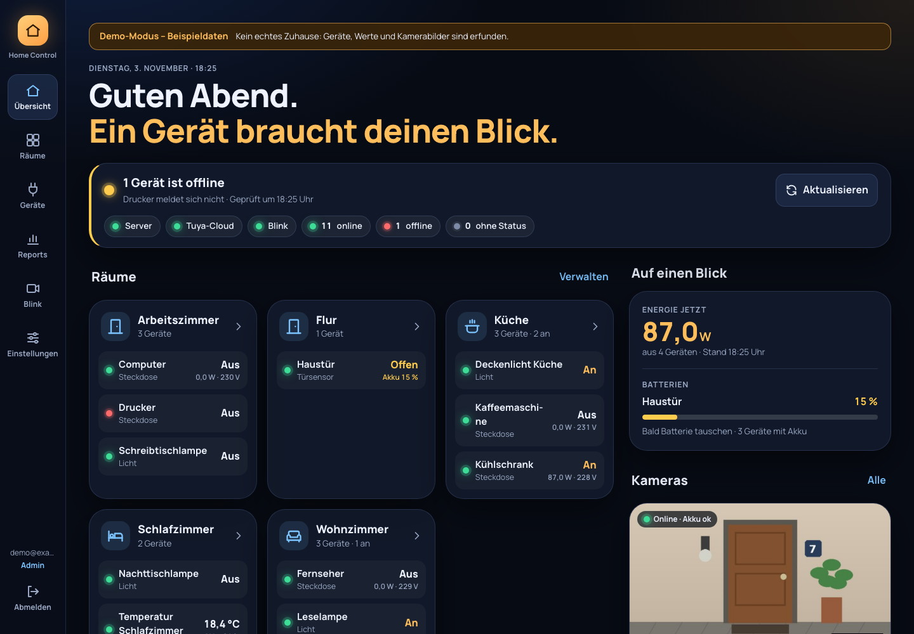
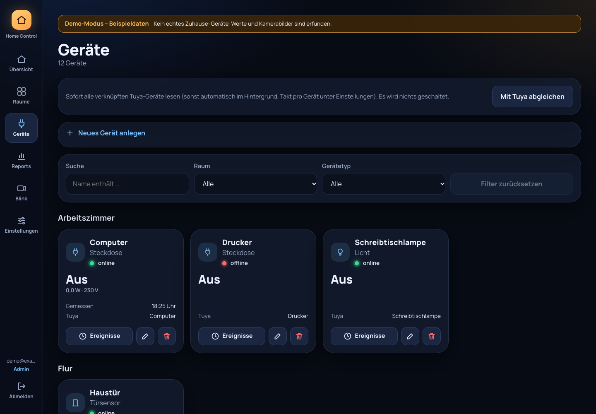
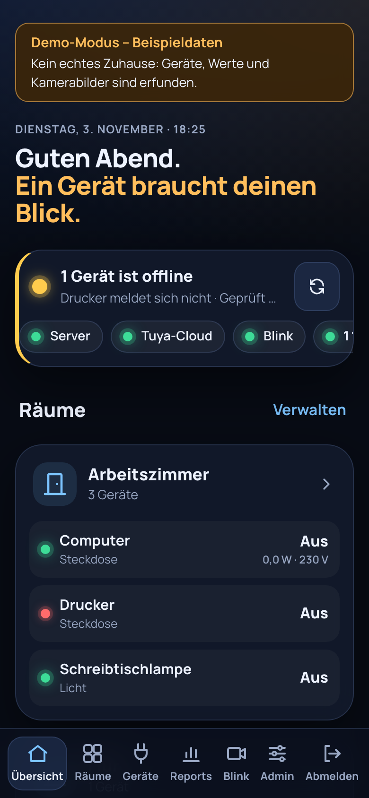
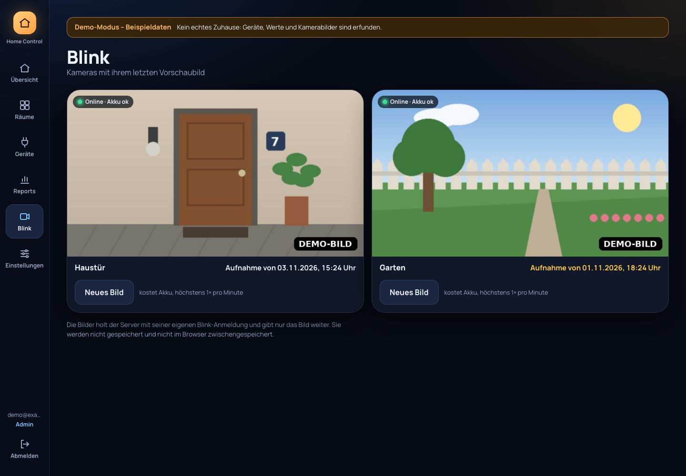
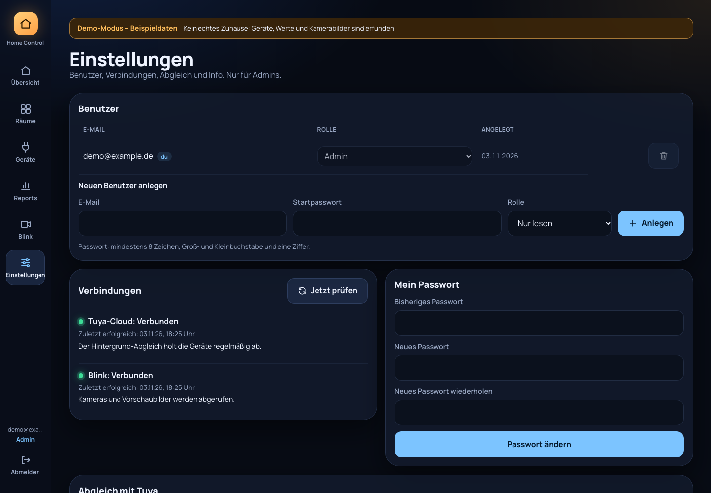
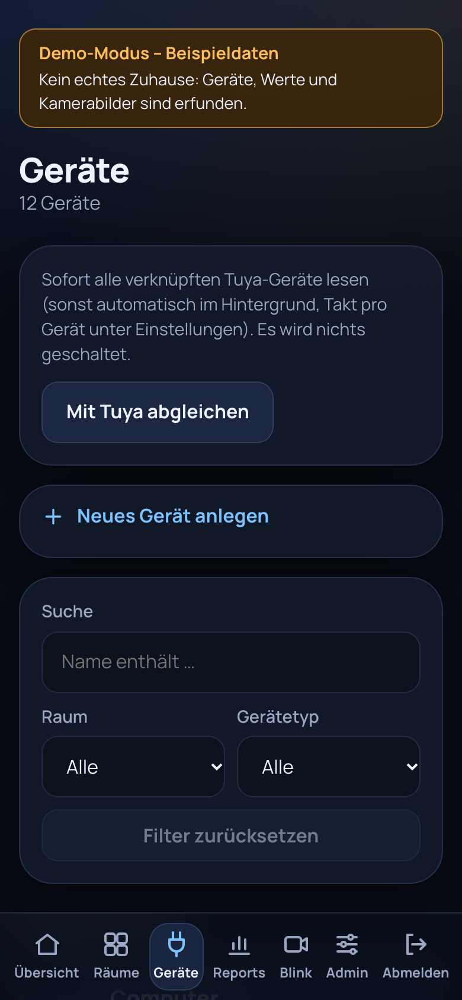
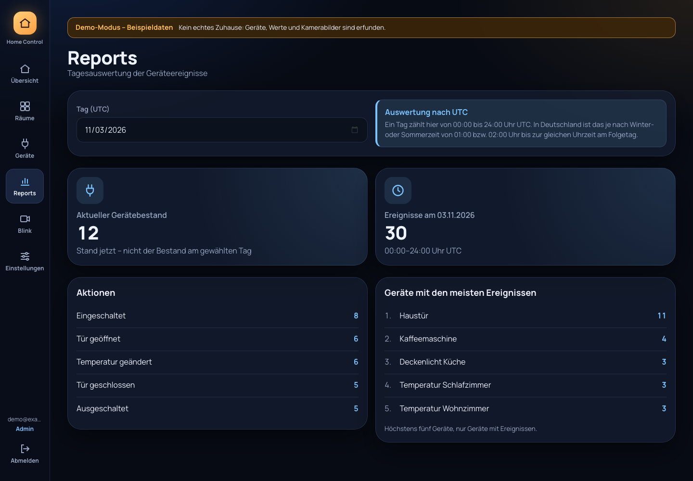
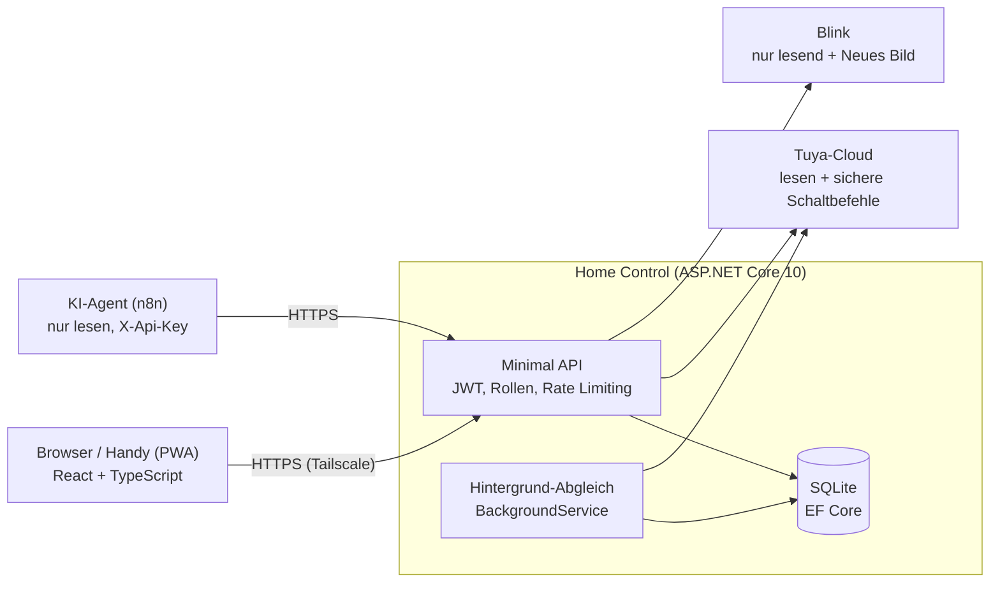

<h1 align="center">🏠 Home Control</h1>

<p align="center">
  <strong>Dein Zuhause auf einen Blick: Räume, Geräte, Energie, Batterien und Kameras –<br>
  aus Tuya, Blink und Open-Meteo, mit sicheren Schaltern für verknüpfte Tuya-Geräte.</strong>
</p>

<p align="center">
  
  
  
  
  
  
  
</p>

<p align="center">
  
</p>

<p align="center"><sub>Alle Bilder stammen aus dem <a href="#demo-in-einer-minute">Demo-Modus</a>: erfundenes Beispielhaus, keine echten Daten.</sub></p>

---

## Was ist Home Control?

Home Control ist eine Web-App für das eigene Zuhause. Sie zeigt in einer ruhigen Oberfläche, **was gerade los ist**:
Welche Geräte an sind, was gerade Strom zieht, welcher Akku bald leer ist, ob die Haustür offen steht und was die
Kameras zuletzt gesehen haben. Dazu gibt es pro Gerät einen Verlauf und eine Tagesauswertung.

Die Gerätewerte kommen aus der **Tuya-Cloud**, die Kamerabilder von **Blink**, und das aktuelle Außenwetter von **Open-Meteo**.
Tuya-Schalter können durch Admins ein- und ausgeschaltet werden, aber nur nach Online-Prüfung und mit bestätigter Rückmeldung.
Außerdem gibt es den Blink-Knopf „Neues Bild“ (nur Admin, höchstens einmal pro Minute und Kamera).

Entstanden ist sie als **Solo-Projekt in der Umschulung zum Software-Ingenieur** (2026/27). Geplant, entschieden
und geprüft habe ich jeden Schritt selbst. Als Werkzeuge habe ich KI-Assistenten (Claude, Codex) eingesetzt, deshalb
steht Claude auch bei den Mitwirkenden.

## Funktionen

| | Bereich | Was die App kann |
|---|---|---|
| 🏠 | **Übersicht** | Begrüßung mit einer Aussage in einem Satz („Ein Gerät braucht deinen Blick“), Status-Leiste mit LEDs (Server, Tuya, Blink, Geräte online/offline), Raumkarten mit Gerätezeilen, „Energie jetzt“, Batterien, Kameras |
| 🌤️ | **Live-Wetter** | Außentemperatur, Sonne/Wolken/Regen, Uhrzeit, Zeitstempel; Open-Meteo und 5-Minuten-Cache |
| 💡 | **Steuern** | Licht, Steckdosen und Schalter mit Tuya-`switch_1` an/aus; Admin-Rechte und echte Zustandsbestätigung |
| 🚪 | **Räume** | Anlegen, umbenennen, löschen, suchen |
| 🔌 | **Geräte** | Anlegen, bearbeiten, löschen, suchen und filtern; Verknüpfung mit einem Tuya-Gerät; Zustand, Watt, Volt, Akku; Verlauf pro Gerät |
| ⏱️ | **Hintergrund-Abgleich** | Holt die Werte automatisch bei Tuya, Takt pro Gerät (Standard 30 Minuten, Tür 3 Minuten), Backoff bei Störungen, Knopf „Mit Tuya abgleichen“ |
| 📊 | **Reports** | Tagesauswertung: Anzahl Ereignisse, Aktionen, Geräte mit den meisten Ereignissen |
| 📷 | **Blink** | Kameras mit letztem Vorschaubild, Akku und Aufnahmezeit (gelb ab einem Tag), „Neues Bild“ für Admins |
| ⚙️ | **Einstellungen** | Benutzer und Rollen verwalten, eigenes Passwort ändern, Verbindungen prüfen, Abgleich-Takt pro Gerät, Systeminfo (nur Admin) |
| 🔐 | **Anmeldung** | Konten mit Rollen Admin und „Nur lesen“, Sperre nach 5 Fehlversuchen, automatische Verlängerung der Sitzung |
| 🤖 | **KI-Agent** | Eigener API-Schlüssel, mit dem ein Agent (n8n) nur lesen darf |
| 📱 | **Handy** | Läuft im Browser und als App auf dem Home-Bildschirm (PWA), Navigation unten, HTTPS über Tailscale |
| 🎭 | **Demo-Modus** | Beispielhaus mit 5 Räumen, 12 Geräten und 7 Tagen Verlauf, für Präsentationen ohne echte Daten |

## Bilder

<table>
  <tr>
    <td width="68%"></td>
    <td width="32%" rowspan="2"></td>
  </tr>
  <tr>
    <td></td>
  </tr>
  <tr>
    <td></td>
    <td rowspan="2"></td>
  </tr>
  <tr>
    <td></td>
  </tr>
</table>

## Demo in einer Minute

Ohne Tuya-Konto, ohne Blink-Konto, ohne Geheimnisse:

```bash
./demo-starten.sh                    # oder mit Docker:  docker compose --profile demo up
```

Dann **http://localhost:5300** öffnen und mit `demo@example.de` anmelden. Das Passwort zeigt das Skript beim Start
an (Standard `Demo-Haus-2026`, nur für die Demo). Oben steht immer das Banner „Demo-Modus – Beispieldaten“. Es gibt
keine Aufrufe an Tuya oder Blink. Die Demo hat eigene Datenbank und eigenen Port und startet nie im Betrieb.
Details: [docs/DEMO.md](docs/DEMO.md).

## Architektur



Das Frontend wird vom Backend mit ausgeliefert, im Betrieb gibt es also nur **eine** Adresse. Das Backend lauscht nur
auf `127.0.0.1`; von außen ist es nur über `tailscale serve` (HTTPS, nur im privaten Tailnet) erreichbar.
Mehr: [Architektur](docs/ARCHITEKTUR.md) · [Datenmodell](docs/DATENMODELL.md) · [API](docs/API.md)

| Bereich | Eingesetzt |
|---|---|
| Backend | C# · ASP.NET Core Minimal API (.NET 10) · Dependency Injection · `BackgroundService` · `TimeProvider` |
| Datenbank | Entity Framework Core · SQLite · Migrationen (beim Start automatisch angewendet) |
| Sicherheit | ASP.NET Core Identity · JWT + Refresh-Token-Rotation · Rollen · Rate Limiting · Data Protection |
| API | REST · DTOs · `AddValidation` + DataAnnotations · ProblemDetails · OpenAPI + Scalar |
| Frontend | React 19 · TypeScript · Vite · eigenes CSS mit Design-Tokens · PWA |
| Anbindungen | Tuya Cloud API (HMAC-SHA256, Token-Cache, Schaltbefehl) · Blink · Open-Meteo |
| Qualität | über 230 xUnit-Tests · oxlint · `./pruefen.sh` (Build, Migrationen, Tests, Frontend, Lint) |
| Betrieb | systemd-Dienst · Tailscale HTTPS · Docker (mehrstufiges Image, nicht als root, Healthcheck) |

## Installation

Es gibt drei Wege. Für alle gilt: **Geheimnisse kommen nie ins Repository.**

### 1. Docker (jeder Rechner mit Docker)

```bash
cp .env.example .env           # Werte eintragen, mindestens Jwt__SigningKey (Befehl steht in der Datei)
docker compose up -d           # http://localhost:5400
```

Datenbank und Schlüssel liegen in Volumes und überleben Updates. Der Container läuft nicht als root und hat einen
Healthcheck (`/healthz`). Details, Update und Umzug: [docs/DOCKER.md](docs/DOCKER.md).

### 2. Dauerdienst auf dem Linux-PC (systemd + Tailscale)

```bash
./jwt-schluessel-einrichten.sh       # einmal: Signaturschlüssel in die .NET User Secrets
./tuya-secrets-einrichten.sh         # optional: Tuya-Zugangsdaten (verdeckte Eingabe)
./dienst-einrichten.sh               # Dienst auf 127.0.0.1:5200 (Production), erneut = Update
./tailscale-https-einrichten.sh      # https://<rechner>.<tailnet>.ts.net für Handy, Tablet, Agent
```

Blink wird einmalig mit `tools/BlinkSpike` eingerichtet (Anmeldung mit 2FA, [docs/BLINK.md](docs/BLINK.md)).
Betrieb, Handy und KI-Agent: [docs/BETRIEB.md](docs/BETRIEB.md).

### 3. Entwickeln

Voraussetzungen: [.NET SDK 10](https://dotnet.microsoft.com/download), [Node.js](https://nodejs.org/) 20.19+ oder
22.12+ (Vorgabe von Vite 8). Geprüft unter Linux Mint und macOS.

```bash
dotnet tool restore                  # dotnet-ef für Migrationen
./app-starten.sh                     # alles unter http://localhost:5111 (Development, API-Doku unter /scalar)
./pruefen.sh                         # Build, Migrationen vollständig, Tests, Frontend-Build, Lint → pruefen.log
```

Oder getrennt in zwei Terminals: `dotnet run` in `backend/HomeControl.Api` (Port 5111) und `npm run dev` in
`frontend` (Port 5173, leitet `/api` an das Backend weiter, deshalb kein CORS nötig).

Datenmodell geändert? Neue Migration anlegen, alte nie ändern:

```bash
dotnet ef migrations add <SprechenderName> --project backend/HomeControl.Api
```

## Direkt verbundene Geräte

Shelly-Schaltkanäle über WLAN liefern lokale Messwerte. Kompatible BLE-Klimasensoren
lassen sich unter Linux direkt mit der Klimaansicht verbinden. [Anleitung](docs/DIREKTE_GERAETE.md)

## Sicherheit

Ein eigenes Review mit Umsetzungsstand liegt in [REVIEW.md](REVIEW.md). Das Wichtigste:

- **Keine Geheimnisse im Repo:** JWT-Schlüssel, Tuya, Blink und Agent-Schlüssel liegen in den .NET User Secrets bzw.
  in der `.env` des Containers. Die Skripte fragen sie verdeckt ab und geben sie nie über die Kommandozeile weiter.
- **Anmeldung:** ASP.NET Core Identity (Passwort-Hash, Sperre nach 5 Fehlversuchen). Kurzes Access Token (15 Minuten),
  Refresh-Token als HTTP-only-Cookie, bei jedem Gebrauch ersetzt; wird ein altes wiederverwendet, enden alle Sitzungen.
- **Rechte:** Schreiben nur Admin. Lesen mit dem Schalter `Auth:RequireLoginForReading` nur angemeldet oder mit
  Agent-Schlüssel (der darf nur lesen); im Dienst und in der Docker-Vorlage ist er an.
- **Rate Limiting:** Login, Registrierung und Refresh pro Gerät begrenzt, Tuya-Abfragen gemeinsam gedeckelt (429 mit
  `Retry-After`). Fehlversuche stehen mit Warnstufe im Log, nie mit Passwort.
- **Netz:** Backend nur auf `127.0.0.1`, von außen nur HTTPS über Tailscale. Im Production-Modus keine API-Doku,
  `Secure`-Cookie und Abbruch, wenn der JWT-Schlüssel fehlt.
- **Kamerabilder:** über das Backend (Proxy), kein Blink-Token im Browser, nicht zwischengespeichert, Pfade gegen SSRF geprüft.

## Grenzen

- **Nur lesend:** Home Control schaltet keine Geräte. Das ist Absicht (Sicherheit und Fokus), keine Lücke.
- **Polling statt Push:** Tuya wird in festen Abständen abgefragt. Eine Tür, die zwischen zwei Abfragen auf- und
  wieder zugeht, fehlt im Verlauf, und als Zeit gilt der Abruf. Jede Abfrage kostet Kontingent bei Tuya.
- **Blink ist inoffiziell:** Es gibt keine offizielle API. Ändert Blink etwas, kann die Anbindung ausfallen.
- **Ein Rechner:** SQLite und der Abgleich sind für genau eine laufende Instanz gebaut.
- **Reports nach UTC:** Ein Tag zählt von 00:00 bis 24:00 Uhr UTC, nicht nach deutscher Uhrzeit.
- **Woher ein Ereignis kommt** (manuell oder vom Gerät), wird noch nicht gespeichert.

## Ausblick

- **Push statt Polling:** Tuya kann jede Gerätemeldung sofort schicken (Message Service, technisch **Apache Pulsar**).
  Dann gäbe es keine verpassten Türöffnungen, die echte Uhrzeit und weniger Abfragen. Zuerst als kleiner Versuch
  (Spike), Plan in [docs/TUYA.md](docs/TUYA.md) „Ausblick: Push statt Polling“.
- **MCP-Server für KI-Assistenten:** Das **Model Context Protocol** ist ein Standard, über den KI-Assistenten Werkzeuge
  aufrufen. Ein kleiner MCP-Server könnte Werkzeuge wie „Welche Geräte sind offline?“ oder „Was ist heute passiert?“
  anbieten, nur lesend und mit dem Agent-Schlüssel, statt dass der Agent rohe HTTP-Aufrufe zusammenbaut.
- **Betrieb auf dem Server:** mit Docker auf einem eigenen Server, Geheimnisse als Umgebungsvariablen.
- **Blink-Clips** vom USB-Speicher des Sync-Moduls anzeigen.
- **Kleinere Verbesserungen:** `TypedResults` in allen Endpunkten, Audit-Log für Admin-Aktionen, GitHub Action mit `./pruefen.sh`.

## Dokumentation

**Einstieg für jede Arbeitssitzung:** [docs/UEBERGABE.md](docs/UEBERGABE.md) (Stand, offene Punkte, Regeln).

[Architektur](docs/ARCHITEKTUR.md) · [Datenmodell](docs/DATENMODELL.md) · [API](docs/API.md) ·
[Authentifizierung](docs/AUTHENTIFIZIERUNG.md) · [Identity](docs/IDENTITY.md) · [Tuya](docs/TUYA.md) ·
[Blink](docs/BLINK.md) · [Rate Limiting](docs/RATE-LIMITING.md) · [Design](docs/DESIGN.md) · [Demo](docs/DEMO.md) ·
[Einstellungen](docs/EINSTELLUNGEN.md) · [Docker](docs/DOCKER.md) · [Betrieb](docs/BETRIEB.md) ·
[Präsentation](docs/PRAESENTATION.md) · [Security-Review](REVIEW.md)

### Lernunterlagen (PDF)

Aktueller gemeinsamer Teststand (Wetter, Tuya und vier Klimasensoren):
[Android-Verbindung und nächster Hardwaretest](docs/ANDROID_SENSOR_BRIDGE.md).

Zu jedem größeren Schritt gibt es eine Lernunterlage: Begriffe, Ablauf, Code-Landkarte, Grenzen und Kurzantworten für
Rückfragen. Erzeugt mit `tools/lernpdf` (Python, reportlab).

| Thema | PDF |
|---|---|
| Authentifizierung und Autorisierung (JWT, Refresh-Token, Rollen, XSS/CSRF) | [Lernunterlage-Authentifizierung.pdf](docs/Lernunterlage-Authentifizierung.pdf) |
| ASP.NET Core Identity (UserManager, IdentityUser, Rollen, Passwort-Hashing, Lockout) | [Lernunterlage-Identity.pdf](docs/Lernunterlage-Identity.pdf) |
| Smart-Home-Geräte verbinden (Tuya-Cloud, Statuscodes, Skalierung, Abgleich) | [Lernunterlage-Tuya-Geraete.pdf](docs/Lernunterlage-Tuya-Geraete.pdf) |
| API-Schlüssel für den KI-Agenten (Anmeldeverfahren, Fallback-Regel, Schalter) | [Lernunterlage-API-Schluessel.pdf](docs/Lernunterlage-API-Schluessel.pdf) |
| Prüfskript und Identity-Migration (pruefen.sh, Exit-Codes, Migrationen, „loss of data“) | [Lernunterlage-Pruefen-und-Migration.pdf](docs/Lernunterlage-Pruefen-und-Migration.pdf) |
| Betrieb: Dienst und HTTPS (systemd, dotnet publish, Ports, tailscale serve, iPhone) | [Lernunterlage-Betrieb.pdf](docs/Lernunterlage-Betrieb.pdf) |
| Status-LEDs (GET /api/status, Cache, Context-Provider, CSS-LEDs, Barrierefreiheit) | [Lernunterlage-Status-LEDs.pdf](docs/Lernunterlage-Status-LEDs.pdf) |
| Energiezähler (Watt, kWh-Schätzung und Messlücken) | [Lernunterlage-Energiezaehler.pdf](docs/Lernunterlage-Energiezaehler.pdf) |
| Tuya-Messwerte (Skalierung, Watt/Volt/Akku, Offline-Werte, reproduzierbare Tests) | [Lernunterlage-Tuya-Messwerte.pdf](docs/Lernunterlage-Tuya-Messwerte.pdf) |
| Production-Modus (Umgebungen, User Secrets im Dienst, Secure-Cookie, Reihenfolge der Konfiguration) | [Lernunterlage-Production-Modus.pdf](docs/Lernunterlage-Production-Modus.pdf) |
| Rate Limiting (Fixed Window, Sliding, Token Bucket, 429, Retry-After, Proxy-Problem, Middleware-Reihenfolge) | [Lernunterlage-Rate-Limiting.pdf](docs/Lernunterlage-Rate-Limiting.pdf) |
| Hintergrund-Abgleich (BackgroundService, PeriodicTimer, Scopes im Singleton, Kontingent-Rechnung, Backoff, Polling vs. Push) | [Lernunterlage-Hintergrund-Abgleich.pdf](docs/Lernunterlage-Hintergrund-Abgleich.pdf) |
| Blink-Anbindung (Geheimnisse über stdin, Token-Rotation, eigener Client statt Blink.NET, kein Login-Kreisel) | [Lernunterlage-Blink-Anbindung.pdf](docs/Lernunterlage-Blink-Anbindung.pdf) |
| Android-Sensor-Bridge (bestehende App ergänzen, USB-Test, Sicherung, Docker-Persistenz) | [Lernunterlage-Android-Sensor-Bridge.pdf](docs/Lernunterlage-Android-Sensor-Bridge.pdf) |
| Tuya-Diagnose und Waage (Online-Abgleich, Datenpunkte, Einheiten, Meldezeit) | [Lernunterlage-Tuya-Diagnose-und-Waage.pdf](docs/Lernunterlage-Tuya-Diagnose-und-Waage.pdf) |
| Geräte-Erreichbarkeit (Berechtigung, offline, Schaltfunktion, Messwert, passives Lauschen) | [Lernunterlage-Geraete-Erreichbarkeit.pdf](docs/Lernunterlage-Geraete-Erreichbarkeit.pdf) |
| Testdaten und Container (Sitzung fortsetzen, SQLite/WAL sichern, Docker-Sensorweg) | [Lernunterlage-Testdaten-und-Container.pdf](docs/Lernunterlage-Testdaten-und-Container.pdf) |
| Waagenansicht (Cloud-Eigenschaften, Feldzeiten, Skalierung, private Zuordnung) | [Lernunterlage-Waagenansicht.pdf](docs/Lernunterlage-Waagenansicht.pdf) |
| Blink-Kamerabilder (Proxy statt Direktlink, kein Token im Browser, Object-URLs, Datenschutz, SSRF) | [Lernunterlage-Blink-Kamerabilder.pdf](docs/Lernunterlage-Blink-Kamerabilder.pdf) |
| Blink „Neues Bild“ (bewusste Ausnahme, Rate Limit pro Kamera, Befehl abfragen statt warten, Admin-Knopf) | [Lernunterlage-Blink-Neues-Bild.pdf](docs/Lernunterlage-Blink-Neues-Bild.pdf) |
| Alarm mit Blink und Türsensor (Türregel, Scharfschalten, Standbilder und USB-Clips) | [Lernunterlage-Alarm-Blink-und-Tuersensor.pdf](docs/Lernunterlage-Alarm-Blink-und-Tuersensor.pdf) |
| Blink-Clips erkunden (lokaler Speicher, Manifest, MP4 prüfen) | [Lernunterlage-Blink-Clips.pdf](docs/Lernunterlage-Blink-Clips.pdf) |
| Design-System (CSS-Variablen, Design-Tokens, Schrift lokal, responsives Layout, Barrierefreiheit) | [Lernunterlage-Design-System.pdf](docs/Lernunterlage-Design-System.pdf) |
| Demo-Modus (Fakes vs. echte Clients, Dependency Injection je nach Einstellung, keine echten Daten auf dem Beamer) | [Lernunterlage-Demo-Modus.pdf](docs/Lernunterlage-Demo-Modus.pdf) |
| Einstellungen (Benutzerverwaltung, letzter Admin, Passwort ändern, Sitzungen beenden ohne Reuse Detection, 409 Conflict) | [Lernunterlage-Einstellungen.pdf](docs/Lernunterlage-Einstellungen.pdf) |
| Docker (Image vs. Container, Layer, Volumes, Multi-Stage, warum nicht root, Secrets nicht ins Image) | [Lernunterlage-Docker.pdf](docs/Lernunterlage-Docker.pdf) |
| Feinschliff (öffentliches Repo aufräumen, einheitliche Zustände, Setup-Endpunkt, portable Skripte, README als Produktseite) | [Lernunterlage-Feinschliff.pdf](docs/Lernunterlage-Feinschliff.pdf) |
| Echtzeit und API (REST, GET und POST, TuyaClient, Server-Sent Events, Tuya-Push, Docker am eigenen Projekt) | [Lernunterlage-Echtzeit-und-API.pdf](docs/Lernunterlage-Echtzeit-und-API.pdf) |
| Präsentation (Spickzettel: Ablauf, Demo-Drehbuch, Architektur, Begriffe, 30 Rückfragen) | [Lernunterlage-Praesentation.pdf](docs/Lernunterlage-Praesentation.pdf) |
| Validierung und Unterricht (AddValidation, DataAnnotations, GetUserId, OpenAPI, Vergleich) | [Lernunterlage-Validierung-und-Unterricht.pdf](docs/Lernunterlage-Validierung-und-Unterricht.pdf) |
| Übergabe und Arbeitsweise (Stand, offene Punkte, Git-Ablauf, mit KI weiterarbeiten) | [Lernunterlage-Uebergabe.pdf](docs/Lernunterlage-Uebergabe.pdf) |

## Projektstruktur

```
backend/HomeControl.Api/        REST API: Endpoints/, Auth/, Tuya/, Blink/, Status/, Demo/, Migrations/
backend/HomeControl.Api.Tests/  xUnit-Tests, API im Arbeitsspeicher, Fakes für Tuya, Blink und die Uhr
frontend/src/                   React-Oberfläche: pages/, components/, api/
docs/                           Dokumentation, Lernunterlagen (PDF), Bilder
tools/BlinkSpike/               Erst-Login bei Blink mit 2FA
tools/lernpdf/                  Erzeugt die Lern-PDFs
*.sh                            Skripte: prüfen, starten, Dienst, Demo, Geheimnisse einrichten
Dockerfile, docker-compose.yml  Container für Betrieb und Demo
```

---

## Über das Projekt

Entwickelt von **Mario Kujoth** als Solo-Projekt während der Umschulung zum Software-Ingenieur (2026/27),
mit KI-Assistenten als Werkzeug.

