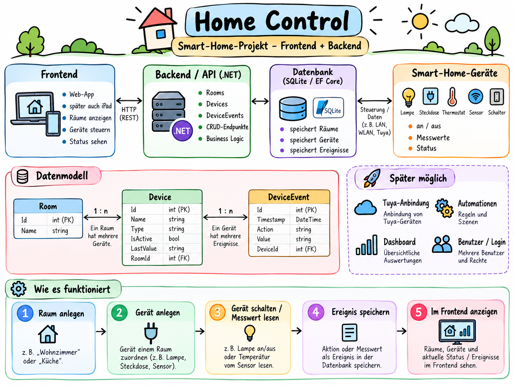

<h1 align="center">🏠 Home Control</h1>

<p align="center">
  <strong>Smart-Home-Web-App zum Verwalten von Räumen, Geräten und ihrem Verlauf –<br>
  mit echter Anbindung an die Tuya-Cloud.</strong>
</p>

<p align="center">
  
  
  
  
  
  
  
</p>

---

Home Control ist mein **Solo-Projekt** aus der Umschulung zum Software-Ingenieur. Von der
Datenbank über die REST API bis zur responsiven Oberfläche habe ich das Projekt geplant,
Entscheidungen getroffen und jeden Schritt geprüft. Als Werkzeuge habe ich dabei
KI-Assistenten (Claude, Codex) eingesetzt, deshalb taucht Claude auch bei den Mitwirkenden
auf. Die App verwaltet Räume und Geräte, speichert pro Gerät einen Ereignisverlauf,
erstellt Tagesauswertungen und liest den **echten Zustand eines Smart-Home-Geräts** aus der
Tuya-Cloud.

## Highlights

- 🔌 **Echte Geräteanbindung:** Ein Tuya-Gerät wird live aus der Cloud gelesen. Ändert sich
  sein Zustand, landet er automatisch im Geräteverlauf. Geschaltet wird bewusst nichts.
- 🔐 **Sicherer Umgang mit Zugangsdaten:** Secrets nur in den .NET User Secrets, nie im Code
  oder im Repository. Das Zugriffstoken wird im Arbeitsspeicher wiederverwendet und
  rechtzeitig vor Ablauf erneuert, auch bei parallelen Anfragen nur einmal.
- 🧱 **Saubere API:** Minimal API mit `MapGroup`, DTOs als Contracts, Validierung mit
  Feldmeldungen, einheitliche Fehler als ProblemDetails und eine OpenAPI-Beschreibung mit
  Scalar-Oberfläche.
- ✅ **Automatisierte Tests:** xUnit-Tests für den Token-Cache (mit eigener Fake-Tuya-Cloud)
  und für den Geräteabgleich (mit SQLite im Arbeitsspeicher). Es geht dabei keine echte
  Anfrage ins Internet.
- 📱 **Responsive Oberfläche:** Dunkles „Night-Control“-Design für Handy, Tablet und Desktop,
  ohne zusätzliches UI-Framework.
- 📚 **Dokumentiert:** Architektur, Datenmodell, API, Tuya-Anbindung und ein
  Präsentationsleitfaden liegen im Ordner [docs/](docs/).

## Architektur



> Die Infografik zeigt die Projektidee einschließlich geplanter Erweiterungen. Im aktuellen
> Code sind IDs vom Typ `Guid` und Ereigniszeitstempel vom Typ `DateTimeOffset`.
> Geräte werden über das Backend angebunden, nicht direkt über die Datenbank. Umgesetzt
> ist bisher die Tuya-Cloud, Blink ist noch ein Platzhalter.
> Details: [Architektur](docs/ARCHITEKTUR.md) · [Datenmodell](docs/DATENMODELL.md)

## Technik

| Bereich | Eingesetzt |
|---|---|
| Backend | C# · ASP.NET Core Minimal API (.NET 10) · Dependency Injection · globaler Exception Handler |
| Datenbank | Entity Framework Core · SQLite · Migrationen (beim Start automatisch angewendet) |
| API | REST · DTOs · Validierung · ProblemDetails · OpenAPI + Scalar |
| Frontend | React · TypeScript · Vite · reines CSS mit CSS-Variablen |
| Integration | Tuya Cloud API (HMAC-SHA256-Signatur, Token-Cache, nur lesend) |
| Qualität | xUnit · oxlint · TypeScript-Prüfung beim Build |

## Funktionen

| Bereich | Was funktioniert |
|---|---|
| Übersicht | Anzahl Räume und Geräte, Räume als Kacheln, Lichtkarte mit echtem Tuya-Zustand |
| Räume | Anlegen, anzeigen, umbenennen, löschen, nach Namen suchen |
| Geräte | Anlegen, anzeigen, bearbeiten (auch Raum wechseln), löschen; Suche nach Namen, Filter nach Raum und Gerätetyp |
| Ereignisse | Verlauf pro Gerät, manuelle Einträge und automatische Einträge aus dem Tuya-Abgleich |
| Reports | Tagesauswertung für einen UTC-Tag: Anzahl Ereignisse, Aktionen, Geräte mit den meisten Ereignissen |
| Tuya | Status eines Geräts lesen (`GET /api/tuya/test-device/status`); Abgleich (`POST /api/tuya/test-device/sync`) überträgt EIN/AUS auf ein verknüpftes Gerät und speichert Änderungen als Ereignis |

## Stand und nächste Schritte

**Bewusste Grenzen des aktuellen Stands:**

- Tuya ist **nur lesend** angebunden und bisher für **ein** Gerät eingerichtet.
- Blink ist ein Platzhalter, eine Anmeldung gibt es noch nicht.
- Woher ein Ereignis kommt (manuell oder vom Gerät), wird noch nicht gespeichert.

**Geplant:**

- Mehrere Tuya-Geräte über eine Geräteliste verknüpfen, statt über die Konfiguration
- Weitere Gerätetypen: Steckdose mit Strommessung, Türkontakt, Akku-Ladestand
- Tests für die Tuya-Signatur und die Endpunkte

Alle Details stehen in [docs/TUYA.md](docs/TUYA.md) unter „Bekannte Grenzen“.

## Dokumentation

[Architektur](docs/ARCHITEKTUR.md) · [Datenmodell](docs/DATENMODELL.md) · [API](docs/API.md) ·
[Tuya-Anbindung](docs/TUYA.md) · [Präsentation](docs/PRAESENTATION.md)

## Lokal starten

### Voraussetzungen

- [.NET SDK 10](https://dotnet.microsoft.com/download)
- [Node.js](https://nodejs.org/) in Version 20.19 oder neuer bzw. 22.12 oder neuer (Vorgabe von Vite 8)
- npm (wird mit Node.js installiert)

Entwickelt und geprüft mit .NET SDK 10.0.113, Node.js 24.22.1 und npm 11.19.1.

### Installation

Im Projektordner:

```bash
# Lokale .NET-Tools installieren (dotnet-ef für Migrationen, siehe dotnet-tools.json)
dotnet tool restore

# Frontend-Pakete installieren
cd frontend
npm install
```

Die NuGet-Pakete des Backends lädt `dotnet run` bzw. `dotnet build` automatisch.

#### Tuya-Zugangsdaten (optional)

Nur nötig, wenn der Tuya-Statusabruf genutzt werden soll. Die Zugangsdaten kommen in die
.NET User Secrets, nicht ins Repository. Im Projektordner:

```bash
./tuya-secrets-einrichten.sh
```

Das Skript fragt Client-ID, Client-Secret und TestDeviceId verdeckt ab. Ohne diese Werte
läuft die App normal, nur der Tuya-Abruf antwortet mit 503. Details in [docs/TUYA.md](docs/TUYA.md).

Optional kann der Zustand des Testgeräts auf ein Gerät in der Datenbank übertragen werden
(`Tuya:LinkedDeviceId`, siehe [docs/TUYA.md](docs/TUYA.md#3-konfiguration)).

### Starten

Backend und Frontend laufen in **zwei getrennten Terminals**.

**Terminal 1 – Backend:**

```bash
cd backend/HomeControl.Api
dotnet run
```

Die API läuft dann unter **http://localhost:5111** (Profil `http` aus
`Properties/launchSettings.json`, Umgebung `Development`).

**Terminal 2 – Frontend:**

```bash
cd frontend
npm run dev
```

Die App öffnet man unter **http://localhost:5173**.

#### Wie Frontend und Backend zusammenhängen

Das Frontend ruft nur Adressen wie `/api/rooms` auf. Der Vite-Entwicklungsserver leitet alles,
was mit `/api` beginnt, an `http://localhost:5111` weiter (siehe `frontend/vite.config.ts`).
Deshalb braucht das Frontend keine feste Backend-Adresse und es gibt keine CORS-Probleme.

Ist Port 5173 schon belegt, weicht Vite automatisch auf 5174 usw. aus (steht im Terminal).

#### API-Dokumentation (Scalar)

Nur im Development-Modus:

- Scalar-Oberfläche: **http://localhost:5111/scalar**
- OpenAPI-Dokument: http://localhost:5111/openapi/v1.json

Scalar läuft direkt am Backend (Port 5111), nicht über den Vite-Port.

### Datenbank und Migrationen

Die SQLite-Datei `homecontrol.db` liegt in `backend/HomeControl.Api/`. Sie wird beim ersten
Start angelegt. Fehlende Migrationen wendet das Backend beim Start automatisch an
(`Database.Migrate()` in `Program.cs`). Die Datei ist in `.gitignore` eingetragen.

Migrationen kann man auch von Hand prüfen oder anwenden (im Projektordner):

```bash
# Welche Migrationen gibt es, welche sind noch offen?
dotnet ef migrations list --project backend/HomeControl.Api

# Migrationen auf die Datenbank anwenden
dotnet ef database update --project backend/HomeControl.Api
```

Bisher gibt es eine Migration: `InitialCreate`.

### Demo-Daten (Seeding)

Das Seeding ist **standardmäßig ausgeschaltet** (`"SeedDemoData": false` in `appsettings.json`).
Es läuft nur, wenn alle drei Bedingungen erfüllt sind:

1. Umgebung ist `Development`
2. `SeedDemoData` ist ausdrücklich `true`
3. Die Datenbank hat noch keine Räume, Geräte und Ereignisse

Es legt drei Räume, vier Geräte und sieben Ereignisse für den heutigen UTC-Tag an.
Alle Namen enden auf „(Demo)“. Vorhandene Daten werden nie verändert oder gelöscht.

Einschalten für einen Start:

```bash
cd backend/HomeControl.Api
dotnet run -- --SeedDemoData=true
```

Hat `homecontrol.db` schon Daten, passiert nichts. Für eine getrennte Demo-Datenbank:

```bash
dotnet run -- --SeedDemoData=true --ConnectionStrings:DefaultConnection="Data Source=demo.db"
```

### Builds und Linter

```bash
# Backend (im Projektordner, baut HomeControl.slnx)
dotnet build
dotnet test     # Tests in backend/HomeControl.Api.Tests

# Frontend (im Ordner frontend)
npm run build   # TypeScript prüfen und Produktions-Build nach frontend/dist
npm run lint    # Linter oxlint
```

## Projektstruktur (Kurzfassung)

```
backend/HomeControl.Api/   REST API (Details in docs/ARCHITEKTUR.md)
backend/HomeControl.Api.Tests/  xUnit-Tests (Tuya-Token-Cache und Tuya-Abgleich)
frontend/src/              React-Oberfläche
docs/                      Dokumentation
HomeControl.slnx           .NET-Lösung
dotnet-tools.json          lokales Tool dotnet-ef
tuya-secrets-einrichten.sh Tuya-Zugangsdaten verdeckt in die User Secrets eintragen
```

---

## Über das Projekt

Entwickelt von **Mario Kujoth** als Solo-Projekt während der Umschulung zum
Software-Ingenieur (2026/27), mit KI-Assistenten als Werkzeug.
