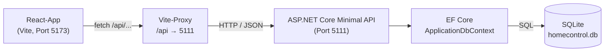

# Architektur

## Überblick

Home Control hat drei Schichten:

**React (Browser) → REST API (ASP.NET Core) → EF Core → SQLite**

1. Die **React-App** zeigt die Oberfläche und schickt HTTP-Anfragen an die API (`fetch`).
2. Die **REST API** prüft die Eingaben, arbeitet mit der Datenbank und antwortet mit JSON.
3. **Entity Framework Core** übersetzt C#-Abfragen (LINQ) in SQL.
4. **SQLite** speichert die Daten in einer einzigen Datei (`homecontrol.db`).



Der Vite-Proxy gibt es nur in der Entwicklung (`npm run dev`). Er sorgt dafür, dass das
Frontend einfach `/api/...` aufrufen kann.

## Ordner im Backend (`backend/HomeControl.Api`)

| Ordner / Datei | Aufgabe |
|---|---|
| `Program.cs` | Startpunkt: Dienste registrieren, Middleware, Migrationen, Seeding, Endpunkte einbinden |
| `Models/` | Datenbank-Klassen: `Room`, `Device`, `DeviceEvent`, `BlinkCredential` |
| `Data/` | `ApplicationDbContext` (Tabellen, Längen, Beziehungen) und `DatabaseSeeder` (Demo-Daten) |
| `Migrations/` | Von EF Core erzeugte Migrationen, u. a. `InitialCreate`, `BlinkAnmeldedatenErgaenzt` |
| `Contracts/` | DTOs: was die API annimmt (`…Request`) und zurückgibt (`…Response`) |
| `Endpoints/` | Minimal-API-Endpunkte, je Bereich eine Datei mit eigener `MapGroup`; `Search.cs` hilft bei der Textsuche |
| `ErrorHandling/` | `GlobalExceptionHandler`: einheitliche Antwort bei unerwarteten Fehlern |
| `Tuya/` | Lesender Zugriff auf die Tuya-Cloud: `TuyaClient` (HTTP), `TuyaTokenStore` (Token-Cache), `TuyaSignature` (HMAC-SHA256), `TuyaOptions` (Einstellungen) |
| `Blink/` | Lesender Zugriff auf Blink (keine offizielle API, siehe [BLINK.md](BLINK.md)): `IBlinkCameraClient` (Abstraktion), `BlinkNetCameraClient` (Blink.NET-Implementierung), `BlinkCredentialStore` (verschlüsseltes Refresh-Token), `BlinkOptions` (Einstellungen) |
| `Properties/launchSettings.json` | Startprofile mit Ports (`http`: 5111) |
| `appsettings.json` | Connection String, Option `SeedDemoData`, `Tuya:BaseUrl` (Zugangsdaten stehen in den User Secrets) |

Die Endpunkte sind in sechs Gruppen aufgeteilt:

| Datei | Gruppe |
|---|---|
| `RoomEndpoints.cs` | `/api/rooms` |
| `DeviceEndpoints.cs` | `/api/devices` |
| `DeviceEventEndpoints.cs` | `/api/devices/{id}/events` |
| `ReportEndpoints.cs` | `/api/reports` |
| `TuyaEndpoints.cs` | `/api/tuya` (bei Tuya nur lesend; der Abgleich `POST /sync` speichert den Zustand in der Datenbank, siehe [TUYA.md](TUYA.md)) |
| `BlinkEndpoints.cs` | `/api/blink` (nur lesend: `GET /status`, `GET /cameras`, siehe [BLINK.md](BLINK.md)) |

## Ordner im Frontend (`frontend/src`)

| Ordner / Datei | Aufgabe |
|---|---|
| `main.tsx` | Startet die React-App |
| `App.tsx` | Merkt sich, welche Seite gerade angezeigt wird (ohne Router) |
| `api/` | Alle Aufrufe an die API. `http.ts` macht daraus verständliche Fehlermeldungen |
| `pages/` | Die Seiten: Übersicht, Räume, Geräte, Reports, Blink (Platzhalter) |
| `components/` | Wiederverwendbare Teile: Kacheln, Formularfelder, Navigation, Icons, Ereignisverlauf, Tuya-Lichtkarte |
| `index.css` | Gesamtes Design (dunkles Navy/Graphit, Cyan-Akzente, responsive) |

Die Navigation ist auf dem Tablet eine Seitenleiste und auf dem Handy eine Leiste unten.
Das wird nur über CSS umgeschaltet.

## Ablauf einer Anfrage (Beispiel: Raum anlegen)

1. Im Formular auf „Anlegen“ klicken → `createRoom()` in `api/rooms.ts` schickt
   `POST /api/rooms` mit `{"name":"Küche"}`.
2. Vite leitet die Anfrage an das Backend weiter.
3. `CreateRoom` in `RoomEndpoints.cs` prüft den Namen. Ist er leer, kommt 400 mit Feldmeldung zurück.
4. Ist alles gültig, wird ein `Room` angelegt und mit `SaveChangesAsync()` gespeichert.
5. Die API antwortet mit 201 und einem `RoomResponse` (`id`, `name`, `deviceCount`).
6. Das Frontend fügt den neuen Raum in die Liste ein.

## Dependency Injection (DI)

Dependency Injection heißt: Eine Klasse erzeugt die Dinge, die sie braucht, nicht selbst.
Sie bekommt sie vom Framework „hineingereicht“. Dazu werden die Dienste in `Program.cs`
einmal registriert.

**DbContext:**

```csharp
builder.Services.AddDbContext<ApplicationDbContext>(options =>
    options.UseSqlite(connectionString));
```

Damit weiß ASP.NET Core, wie es einen `ApplicationDbContext` erzeugt. Er ist „scoped“:
Jede HTTP-Anfrage bekommt ihren eigenen DbContext, der danach wieder freigegeben wird.
Ein Endpunkt schreibt ihn einfach als Parameter hin:

```csharp
private static async Task<IResult> GetAllRooms(string? q, ApplicationDbContext db)
```

Minimal API erkennt den Typ und reicht den passenden DbContext hinein.

**DatabaseSeeder:**

```csharp
builder.Services.AddScoped<DatabaseSeeder>();
```

Der Seeder bekommt DbContext und Logger über seinen Konstruktor:

```csharp
public class DatabaseSeeder(ApplicationDbContext db, ILogger<DatabaseSeeder> logger)
```

Beim Start gibt es noch keine HTTP-Anfrage. Deshalb erzeugt `Program.cs` selbst einen
Bereich (`CreateScope()`) und holt sich daraus DbContext und Seeder:

```csharp
using (var scope = app.Services.CreateScope())
{
    var db = scope.ServiceProvider.GetRequiredService<ApplicationDbContext>();
    db.Database.Migrate();
    // ... danach ggf. DatabaseSeeder
}
```

Auch der `GlobalExceptionHandler` bekommt seinen Logger und den `IProblemDetailsService`
per DI.

**TuyaClient:**

```csharp
builder.Services.Configure<TuyaOptions>(builder.Configuration.GetSection(TuyaOptions.SectionName));
builder.Services.AddSingleton(TimeProvider.System);
builder.Services.AddSingleton<TuyaTokenStore>();
builder.Services.AddHttpClient<TuyaClient>(...);
```

`Configure` bindet den Abschnitt `Tuya` (aus `appsettings.json` und den User Secrets) an
`TuyaOptions`. `AddHttpClient` registriert den `TuyaClient` mit einem eigenen `HttpClient`
(BaseUrl, 10 Sekunden Timeout).

Lebensdauer: Ein typisierter HttpClient wie `TuyaClient` ist **transient**, er wird pro Anfrage
neu erzeugt. Deshalb liegt das Tuya-Token im `TuyaTokenStore`, einem **Singleton**, das für
die ganze Laufzeit der App einmal existiert. `TimeProvider.System` liefert die echte Uhrzeit.
In Tests wird stattdessen eine steuerbare Uhr übergeben. Nach einem Wechsel der Zugangsdaten
wird das Backend neu gestartet (siehe [TUYA.md](TUYA.md)).

**BlinkNetCameraClient:**

```csharp
builder.Services.Configure<BlinkOptions>(builder.Configuration.GetSection(BlinkOptions.SectionName));
builder.Services.AddScoped<BlinkCredentialStore>();
builder.Services.AddSingleton<IBlinkCameraClient, BlinkNetCameraClient>();
```

Anders als `TuyaClient` ist `BlinkNetCameraClient` selbst ein **Singleton**: Der zugrunde
liegende `BlinkClient` aus Blink.NET hält den Login-Zustand (Account-Id, interner
`HttpClient`) in sich selbst, ein Neuanlegen pro Anfrage würde jedes Mal einen neuen Login
erzwingen. Ein Singleton darf aber keinen scoped Dienst wie `BlinkCredentialStore` (braucht
den `ApplicationDbContext`) direkt im Konstruktor bekommen – das wäre ein „captive
dependency“-Fehler. Deshalb bekommt `BlinkNetCameraClient` stattdessen ein
`IServiceScopeFactory` und öffnet sich bei Bedarf selbst einen kurzlebigen Scope:

```csharp
using var scope = scopeFactory.CreateScope();
var store = scope.ServiceProvider.GetRequiredService<BlinkCredentialStore>();
```

Die Data Protection API (verschlüsselt das Refresh-Token in der Datenbank) wird direkt
daneben registriert, mit Schlüsseln außerhalb des Repos (siehe [BLINK.md](BLINK.md)):

```csharp
builder.Services.AddDataProtection()
    .SetApplicationName("HomeControl")
    .PersistKeysToFileSystem(new DirectoryInfo(dataProtectionKeyPath));
```

## Tests (`backend/HomeControl.Api.Tests`)

xUnit-Projekt, eingetragen in `HomeControl.slnx`, Start mit `dotnet test`. Es gibt Tests für
den Tuya-Token-Cache, die Tuya-Geräteliste, den Tuya-Abgleich und den Blink-Credential-Store.
Statt eines Mocking-Frameworks gibt es kleine eigene Fakes im Ordner `Fakes/`: Ein
`HttpMessageHandler` ersetzt die Tuya-Cloud, ein `TimeProvider` lässt sich vorspulen. Für
Blink genügt `EphemeralDataProtectionProvider` aus ASP.NET Core selbst (kein eigener Fake
nötig) plus SQLite im Arbeitsspeicher wie beim Tuya-Abgleich.

## Fehlerbehandlung (Middleware-Reihenfolge)

In `Program.cs` stehen ganz vorne:

1. `UseExceptionHandler()` fängt alle unerwarteten Exceptions ab und gibt sie an den
   `GlobalExceptionHandler` weiter. Kaputtes JSON führt zu 400, alles andere zu 500
   mit allgemeiner Meldung. Details landen nur im Server-Log.
2. `UseStatusCodePages()` gibt Fehlerantworten ohne Inhalt (z. B. 404 bei unbekannter Route)
   ebenfalls als ProblemDetails aus.

Danach folgen Migrationen, Scalar (nur Development) und die Endpunkte.
