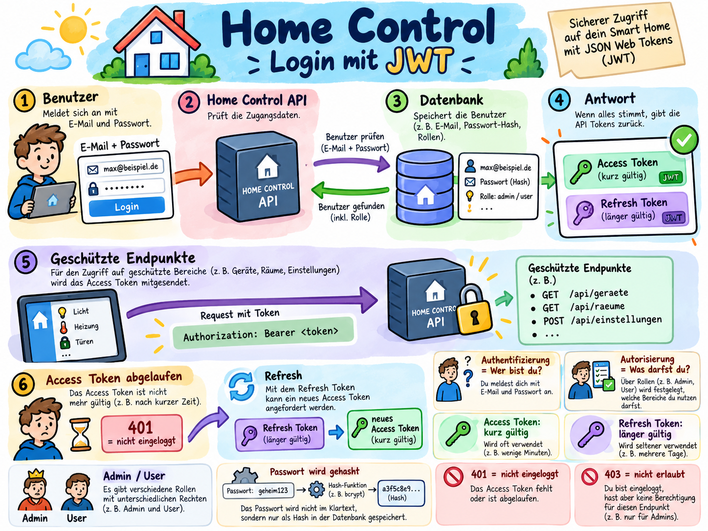
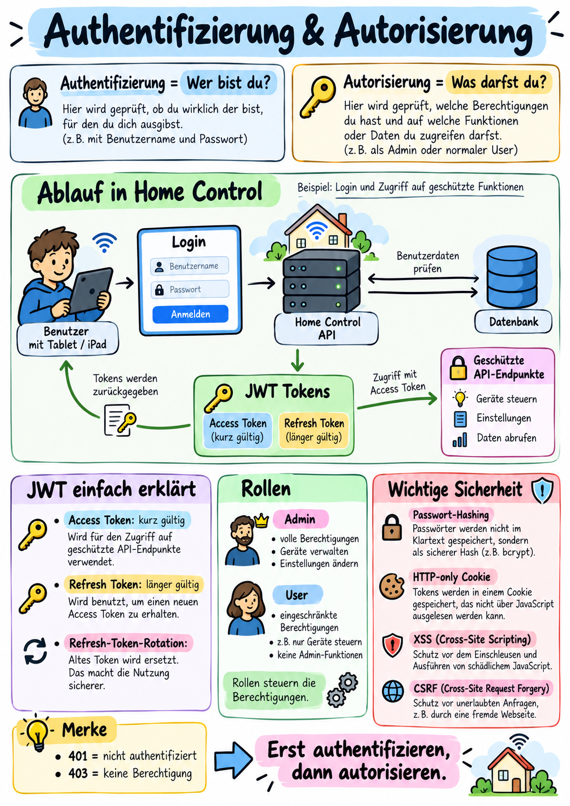

# Authentifizierung und Autorisierung

> **In Arbeit** auf dem Branch `feature/authentication`. Die ausführliche Erklärung
> (JWT, Refresh-Token-Rotation, Passwort-Hashing, XSS, CSRF, Auth-Flow) folgt, sobald der
> Code steht.

**Zum Lernen:** [Lernunterlage-Authentifizierung.pdf](Lernunterlage-Authentifizierung.pdf)
(11 Seiten: Grundbegriffe, JWT, Rotation, Passwort-Hashing, Rollen, XSS/CSRF, Ablauf, Code,
Grenzen, Kurzantworten für Rückfragen, Merksätze).

## Überblick in Bildern

> Die Infografiken zeigen das Prinzip. In einigen Punkten weicht Home Control davon ab:
>
> - **Refresh-Token ist kein JWT.** Nur das Access Token ist ein JWT. Das Refresh-Token ist
>   eine lange Zufallszeichenkette. In der Datenbank steht nur ihr SHA-256-Hash.
> - **Passwort-Hashing mit PBKDF2, nicht bcrypt.** Home Control nutzt den `PasswordHasher`
>   von ASP.NET Core (PBKDF2 mit Salt). Das Prinzip ist dasselbe: langsamer Hash, nie Klartext.
> - **Nur das Refresh-Token liegt im HTTP-only Cookie.** Das Access Token speichert das
>   Frontend im Local Storage und schickt es als `Authorization: Bearer <token>` mit.
> - **Anmeldung mit E-Mail**, nicht mit Benutzername.
> - **Geräte werden nicht gesteuert.** Tuya und Blink sind nur lesend angebunden. Rollen
>   regeln vorerst, wer Räume und Geräte in Home Control anlegen, ändern und löschen darf
>   (Admin) und wer nur lesen darf (User).

## Wer darf was (Stand jetzt)

| Bereich | Ohne Anmeldung | User | Admin |
|---|---|---|---|
| Räume, Geräte, Ereignisse, Reports, Tuya, Blink lesen (`GET`) | ja | ja | ja |
| Räume und Geräte anlegen, ändern, löschen | 401 | 403 | ja |
| Ereignis speichern (manueller Testeintrag) | 401 | 403 | ja |
| Weitere Benutzer anlegen (`POST /api/auth/register`) | 401* | 403 | ja |
| Eigenes Profil (`GET /api/auth/profile`) | 401 | ja | ja |
| Tuya-Abgleich (`POST /api/tuya/test-device/sync`) | 401 | ja | ja |

\* Nur solange es noch keinen Benutzer gibt, ist die Registrierung offen. Der erste Benutzer
wird automatisch Admin.

Umsetzung: Die Regel `AdminOnly` (`Auth/AuthPolicies.cs`, verlangt die Rolle Admin) wird in
`Program.cs` registriert und an den schreibenden Endpunkten mit
`.RequireAuthorization(AuthPolicies.AdminOnly)` angehängt.

**Bewusst noch offen:**

- **Lesen ohne Anmeldung** ist standardmäßig noch erlaubt, damit der n8n-Agent weiterläuft.
  Mit dem Schalter `Auth:RequireLoginForReading` (siehe unten) wird auch Lesen geschützt.
- **Alles andere im Frontend** wird bei der Anmeldung nur ausgeblendet (Buttons für Admins), das
  Backend prüft die Rolle aber immer selbst. Ausgeblendete Buttons sind Komfort, kein Schutz.

Getestet in `AdminOnlyEndpointTests` (echte API im Arbeitsspeicher über
`WebApplicationFactory`, eigene SQLite-Datei im Temp-Ordner): 401 ohne Token und mit
ungültigem Token, 403 als User, Lesen ohne Anmeldung, Admin darf alles.

## Schlüssel für den KI-Agenten (n8n)

Der Agent hat kein Passwort und keinen Browser. Er schickt bei jedem Aufruf den Header
`X-Api-Key: <Schlüssel>`. Der Schlüssel steht nur in den User Secrets (`Agent:ApiKey`).

| Teil | Aufgabe |
|---|---|
| `agent-schluessel-einrichten.sh` | Erzeugt einen zufälligen Schlüssel, speichert ihn in den User Secrets und zeigt ihn **einmal** an |
| `Auth/ApiKeyAuthenticationHandler.cs` | Prüft den Header in konstanter Zeit (SHA-256 beider Seiten, `FixedTimeEquals`) |
| `Auth/AuthPolicies.cs` | `CreateReadingPolicy`: angemeldet per JWT **oder** API-Schlüssel |
| `Auth:RequireLoginForReading` | Schalter in `appsettings.json` (Standard `false`) |

**Was der Schlüssel darf:** nur lesen. Schreibende Endpunkte prüfen die Rolle Admin im JWT, ein
Schlüssel öffnet sie nie (401). So kann ein gestohlener Agent-Schlüssel nichts löschen.

**Einschalten, ohne den Agenten zu verlieren:**

1. `./agent-schluessel-einrichten.sh` ausführen, Schlüssel kopieren, Backend neu starten.
2. In n8n bei den HTTP-Request-Knoten für Home Control den Header `X-Api-Key` setzen, am besten
   als wiederverwendbare Zugangsdaten (Header Auth) und nicht im Workflow-Text.
3. Prüfen, dass der Agent weiter Daten bekommt.
4. Erst dann `Auth:RequireLoginForReading` auf `true` setzen (z. B. `dotnet user-secrets set
   "Auth:RequireLoginForReading" true`) und das Backend neu starten.

Mit dem Schalter an gilt für jeden Endpunkt ohne eigene Regel (alle `GET`) eine Anmeldung. Offen
bleiben nur `register`, `login`, `refresh`, `logout`, `GET /` und im Development die
API-Dokumentation. Die Frontend-Anmeldeseite funktioniert unverändert, weil es hinter dem Login
mit dem JWT liest.

Getestet in `ReadingProtectionTests`: Lesen ohne Anmeldung 401, mit Schlüssel 200, falscher
Schlüssel 401, Schreiben mit Schlüssel 401, Lesen mit Benutzer-Token 200, Anmeldung bleibt offen.

## Frontend-Login

| Datei | Aufgabe |
|---|---|
| `src/api/tokenStore.ts` | Access Token merken (Local Storage), Refresh mit Sperre: immer nur **ein** Refresh gleichzeitig |
| `src/api/http.ts` | `send()` hängt `Authorization: Bearer ...` an. Bei 401 einmal Refresh, dann Aufruf wiederholen |
| `src/api/auth.ts` | login, register, logout, Profil, Sitzung beim Start wiederherstellen |
| `src/auth/AuthProvider.tsx`, `authContext.ts` | Wer ist angemeldet? Context mit `useAuth()` (`user`, `isAdmin`, `signIn`, `signOut`) |
| `src/pages/LoginPage.tsx` | Anmeldeformular, beim ersten Start auch „Erstes Konto anlegen“ (wird Admin) |

Ablauf:

1. **Start:** Liegt ein Access Token im Local Storage, fragt die App das Profil ab. Ist es
   abgelaufen (401), holt `send()` per Refresh-Cookie ein neues. Ohne Token wird direkt ein
   Refresh versucht. Klappt nichts, erscheint die Anmeldeseite.
2. **Normaler Betrieb:** Jeder Aufruf geht mit dem Access Token raus. Wird es während der Nutzung
   ungültig, merkt der Benutzer nichts: Refresh, dann derselbe Aufruf noch einmal.
3. **Refresh abgelehnt** (Cookie abgelaufen, Logout in einem anderen Tab, Reuse Detection):
   Sitzung beendet, Anmeldeseite.
4. **Abmelden:** Der Server widerruft das Refresh-Token und löscht das Cookie, das Frontend
   vergisst das Access Token.

**Warum nur ein Refresh gleichzeitig?** Das Backend tauscht das Refresh-Token bei jedem Refresh
aus (Rotation). Zwei gleichzeitige Refreshs mit demselben Token sähen aus wie ein gestohlenes,
wiederverwendetes Token (Reuse Detection) und würden den Benutzer ausloggen. React StrictMode
startet Effekte im Development doppelt, und mehrere Aufrufe können gleichzeitig mit abgelaufenem
Token ankommen. Deshalb teilen sich alle Aufrufer dasselbe Refresh-Versprechen
(`refreshInFlight`).

**Bekannte Grenze:** Das Access Token im Local Storage könnte bei einer XSS-Lücke gelesen werden.
Es gilt nur 15 Minuten, das gefährlichere Refresh-Token liegt im HTTP-only Cookie.

## Merksätze

- **Authentifizierung** = Wer bist du? **Autorisierung** = Was darfst du?
  Erst authentifizieren, dann autorisieren.
- **401** = nicht (korrekt) angemeldet: Token fehlt, ist ungültig oder abgelaufen.
- **403** = angemeldet, aber nicht berechtigt (z. B. ein User ruft eine Admin-Funktion auf).
