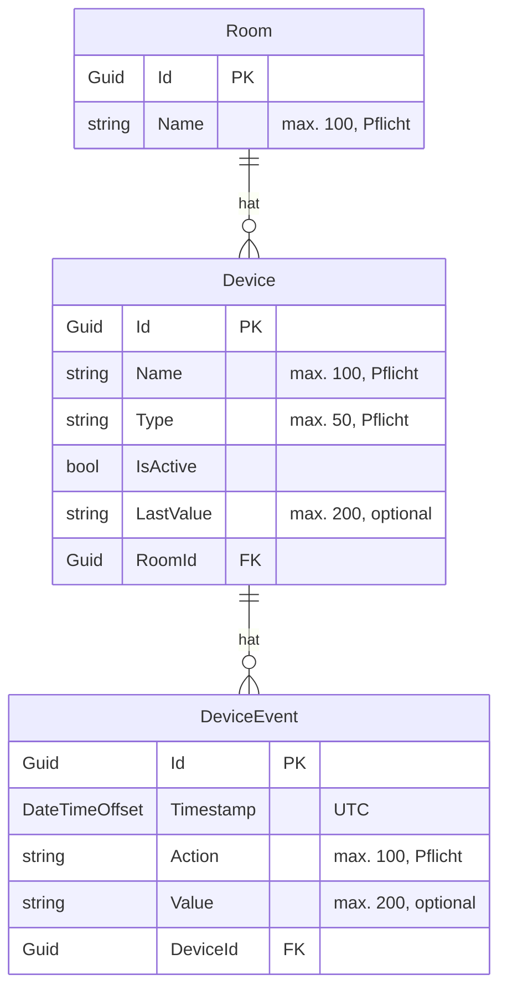

# Datenmodell

Es gibt drei Tabellen: **Rooms**, **Devices** und **DeviceEvents**.
Die Klassen stehen in `backend/HomeControl.Api/Models/`, die Regeln (Längen, Beziehungen)
in `Data/ApplicationDbContext.cs`.



## Die drei Klassen

### Room (Raum)

| Feld | Bedeutung |
|---|---|
| `Id` | Eindeutige Kennung (GUID) |
| `Name` | Name des Raums, höchstens 100 Zeichen |
| `Devices` | Alle Geräte in diesem Raum |

### Device (Gerät)

| Feld | Bedeutung |
|---|---|
| `Id` | Eindeutige Kennung (GUID) |
| `Name` | Name des Geräts, höchstens 100 Zeichen |
| `Type` | Gerätetyp, höchstens 50 Zeichen. Neue Geräte: `Light`, `Socket`, `TemperatureSensor`, `DoorSensor`, `Switch` |
| `IsActive` | Ob das Gerät an ist. **Wird derzeit nicht gepflegt** (siehe unten) |
| `LastValue` | Letzter Messwert. **Wird derzeit nicht gepflegt** (siehe unten) |
| `RoomId` / `Room` | Zu welchem Raum das Gerät gehört |
| `Events` | Ereignisverlauf des Geräts |

### DeviceEvent (Geräteereignis)

| Feld | Bedeutung |
|---|---|
| `Id` | Eindeutige Kennung (GUID) |
| `Timestamp` | Zeitpunkt in UTC |
| `Action` | Was passiert ist: `turned_on`, `turned_off`, `temperature_changed`, `door_opened`, `door_closed` |
| `Value` | Optionaler Wert, z. B. „21,5 °C“, höchstens 200 Zeichen |
| `DeviceId` / `Device` | Zu welchem Gerät das Ereignis gehört |

## Beziehungen

- Ein **Raum** hat **viele Geräte** (1:n). Jedes Gerät gehört zu genau einem Raum.
- Ein **Gerät** hat **viele Ereignisse** (1:n). Jedes Ereignis gehört zu genau einem Gerät.

In EF Core ist das im `ApplicationDbContext` so eingestellt:

```csharp
entity.HasMany(r => r.Devices)
    .WithOne(d => d.Room)
    .HasForeignKey(d => d.RoomId)
    .OnDelete(DeleteBehavior.Cascade);
```

## Kaskadierendes Löschen

Beide Beziehungen verwenden `DeleteBehavior.Cascade`. Das heißt:

- **Raum löschen** → alle Geräte in diesem Raum **und** deren gesamter Ereignisverlauf
  werden mitgelöscht.
- **Gerät löschen** → der gesamte Ereignisverlauf dieses Geräts wird mitgelöscht.

Das kann nicht rückgängig gemacht werden. Der Ereignisverlauf geht dabei verloren und
fehlt danach auch in den Tagesauswertungen. Die Oberfläche weist in der Löschbestätigung
ausdrücklich darauf hin.

## Zeitstempel in UTC

- Den Zeitpunkt eines Ereignisses setzt immer der **Server**, nicht das Frontend.
- Er wird in **UTC** gesetzt (`DateTimeOffset.UtcNow`).
- In der Datenbank steht er als Zahl: Millisekunden seit dem 01.01.1970 UTC (Unix-Zeit).
  Diese Umwandlung ist im DbContext mit `HasConversion` eingestellt. Genauer als
  Millisekunden wird nicht gespeichert.
- Die Oberfläche zeigt den Zeitpunkt in der Ortszeit des Browsers an.
- Die Tagesauswertung rechnet mit **UTC-Tagen** (siehe [API.md](API.md)).

## Was IsActive und LastValue (noch) nicht tun

`IsActive` und `LastValue` gibt es im Modell, sie werden aber **nicht** durch Ereignisse
aktualisiert. Ein Ereignis wie `turned_on` wird nur gespeichert. Das Gerät bleibt dabei
unverändert. Es gibt noch keine echte Geräteanbindung (Tuya/Blink), die diese Werte liefern
könnte.

Deshalb:

- zeigt die Oberfläche beim Zustand „Noch keine Daten“,
- gibt die API `IsActive` gar nicht aus,
- gibt es keinen Filter und keine Auswertung nach „aktiven Geräten“.

Außerdem speichert ein Ereignis noch nicht, **woher** es kommt (manuell oder von einem Gerät).
Dafür wäre ein zusätzliches Feld und eine neue Migration nötig.
