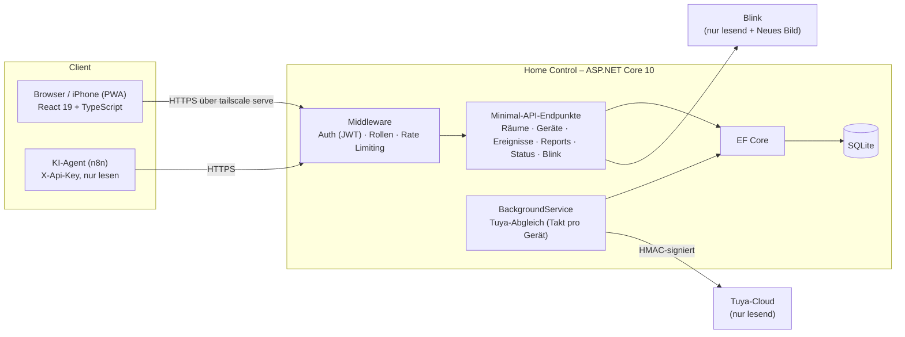

# Präsentation (10–15 Minuten)

Leitfaden für die Vorstellung von Home Control in der Schule am **Montag, 09.11.2026**. Alles, was gezeigt wird,
läuft im **Demo-Modus**: erfundenes Beispielhaus, keine echten Geräte, keine echten Kamerabilder.

**Spickzettel zum Ausdrucken:** [Lernunterlage-Praesentation.pdf](Lernunterlage-Praesentation.pdf) (4 Seiten)

## 1. Vorbereitung

**Am Vorabend**

1. `git pull` auf dem Rechner, mit dem präsentiert wird, dann `./pruefen.sh` (muss „Alles grün.“ sagen).
2. `./demo-starten.sh` einmal komplett durchlaufen lassen (baut Frontend und Backend, das dauert beim ersten Mal).
3. Plan B bereitlegen: die Bilder in [images/screenshots/](images/screenshots/) und die README auf GitHub.

**15 Minuten vorher**

1. Terminal: `./demo-starten.sh` (frisches Beispielhaus, Verlauf der letzten 7 Tage bis heute).
2. Browser: `http://localhost:5300`, anmelden mit `demo@example.de` und dem Passwort aus dem Terminal.
3. Zoom auf 125 % (Beamer), Benachrichtigungen aus, keine anderen Tabs mit privaten Daten.
4. Zweiter Tab: Entwicklerwerkzeuge → Gerätesymbolleiste → iPhone (390 px), für die Handy-Ansicht.
5. Im Editor schon geöffnet: `Program.cs`, `Tuya/TuyaSyncBackgroundService.cs`, `Demo/DemoMode.cs`.

## 2. Ablauf

| Zeit | Teil | Was ich zeige | Kernsatz |
|---|---|---|---|
| 0:00–1:00 | Einstieg | Übersicht im Browser | „Ich wollte mit einem Blick sehen, was zu Hause los ist, ohne fünf Apps zu öffnen.“ |
| 1:00–2:30 | Ziel und Funktionen | README-Tabelle „Funktionen“ | „Home Control liest Tuya und Blink und schaltet bewusst nichts.“ |
| 2:30–4:30 | Architektur | Diagramm unten | „React im Browser, eine Minimal API mit ASP.NET Core, SQLite über EF Core, dazu ein Hintergrunddienst.“ |
| 4:30–10:00 | Live-Demo | Drehbuch (Abschnitt 3) | „Alles, was Sie sehen, ist der echte Code – nur die Cloud dahinter ist gespielt.“ |
| 10:00–12:00 | Technik | Sicherheit, Abgleich, Tests | „Das Schwierigste waren nicht die Seiten, sondern Anmeldung, Geheimnisse und Kontingent.“ |
| 12:00–13:30 | Grenzen und Gelernt | Abschnitt 6 und 7 | „Polling verpasst kurze Türöffnungen. Das weiß ich und habe einen Plan.“ |
| 13:30–15:00 | Ausblick, Fragen | Abschnitt 8 | „Als Nächstes Push statt Polling und ein MCP-Server für KI-Assistenten.“ |

Wird es knapp: Reports und Einstellungen in der Demo weglassen, Technik auf Sicherheit kürzen.

## 3. Demo-Drehbuch (ca. 5½ Minuten)

| # | Klick | Was man sieht | Was ich sage |
|---|---|---|---|
| 1 | Anmeldeseite | Banner „Demo-Modus – Beispieldaten“, E-Mail vorausgefüllt | „Das ist eine zweite Instanz mit Beispielhaus. Echte Daten zeige ich auf dem Beamer nicht.“ |
| 2 | Anmelden | Übersicht: „Ein Gerät braucht deinen Blick.“ | „Die App sagt in einem Satz, ob alles in Ordnung ist.“ |
| 3 | Status-Leiste | LEDs Server, Tuya-Cloud, Blink, 11 online, 1 offline | „Der Drucker ist ausgesteckt. Die LEDs lesen nur den Speicher, sie kosten keine Tuya-Aufrufe.“ |
| 4 | Raumkarte Küche | Kühlschrank mit Watt und Volt | „Messwerte kommen von Tuya als ganze Zahlen und werden skaliert, z. B. Watt durch 10.“ |
| 5 | Karte „Energie jetzt“ und „Batterien“ | Summe in Watt, Haustür 15 % gelb | „Ab 20 % wird eine Batterie gelb, damit ich sie tausche, bevor der Sensor ausfällt.“ |
| 6 | Navigation „Geräte“ | Kacheln pro Raum, Filter | „Hier verknüpfe ich ein Gerät mit seinem Tuya-Gerät. Danach gleicht der Hintergrunddienst es ab.“ |
| 7 | Haustür → „Ereignisse“ | Verlauf: Tür geöffnet/geschlossen | „Jede Änderung landet als Ereignis in der Datenbank. Daraus entstehen die Reports.“ |
| 8 | „Mit Tuya abgleichen“ | Meldung „… verknüpfte Geräte abgeglichen, … geändert“ | „Sofort abgleichen geht auch von Hand. Es wird nur gelesen, nie geschaltet.“ |
| 9 | Navigation „Reports“ | Tagesauswertung, Top-Geräte | „Gezählt wird ein UTC-Tag, so wie die Zeiten in der Datenbank stehen. Der Hinweiskasten rechnet es in deutsche Zeit um.“ |
| 10 | Navigation „Blink“ | Zwei Kameras, Garten-Aufnahme gelb | „Gelb heißt: Das Bild ist älter als ein Tag. Die Bilder holt der Server, der Browser sieht nie das Blink-Token.“ |
| 11 | „Neues Bild“ bei Haustür | Kurz „Kamera nimmt auf …“, dann neues Bild mit Aufnahmezeit jetzt | „Die einzige bewusste Ausnahme von ‚nur lesend‘: nur Admin, höchstens einmal pro Minute, weil es Akku kostet.“ |
| 12 | Gleich noch einmal „Neues Bild“ | Meldung „… höchstens einmal pro Minute …“ (429) | „Das Rate Limit greift. Die Kamera wird nicht leergesaugt.“ |
| 13 | Navigation „Einstellungen“ | Benutzer, Verbindungen, Abgleich-Takt, Info | „Nur Admins sehen diese Seite. Die Tür frage ich alle 3 Minuten ab, den Rest alle 30, wegen des Kontingents.“ |
| 14 | Handy-Tab (390 px) | Navigation unten | „Dieselbe App auf dem iPhone, als PWA auf dem Home-Bildschirm, über HTTPS im privaten Tailscale-Netz.“ |

Läuft etwas schief: ruhig bleiben, auf Plan B (Screenshots) wechseln und sagen, was man sehen würde.

## 4. Architekturbild

So erzählen: **von links nach rechts.** Der Browser schickt eine Anfrage, die Middleware prüft Anmeldung, Rolle und
Rate Limit, der Endpunkt liest über EF Core aus SQLite. Unabhängig davon holt der Hintergrunddienst regelmäßig die
Werte bei Tuya und speichert Änderungen als Ereignis. Im Demo-Modus ist nur die Tuya-Cloud durch eine Fake-Cloud
ersetzt, der Rest ist derselbe Code.

## 5. Wichtigste Fachbegriffe (je ein Satz)

| Begriff | In einem Satz |
|---|---|
| Minimal API | Endpunkte werden direkt mit `app.MapGet(...)` als Funktionen beschrieben, ohne Controller-Klassen. |
| REST | Ressourcen (Räume, Geräte) haben Adressen, und HTTP-Methoden (GET, POST, PUT, DELETE) sagen, was passieren soll. |
| DTO / Contract | Eine kleine Klasse nur für Ein- und Ausgabe der API, damit das Datenbankmodell nicht nach außen geht. |
| Entity Framework Core | Ein ORM, das C#-Klassen auf Tabellen abbildet und SQL parametrisiert erzeugt. |
| Migration | Eine versionierte Änderung am Datenbankschema; alte Migrationen ändert man nie. |
| Dependency Injection | ASP.NET Core erzeugt Dienste und reicht sie an die Stellen weiter, die sie brauchen. |
| Middleware | Ein Baustein in der Kette, durch die jede Anfrage läuft (z. B. Anmeldung, Rate Limiting); die Reihenfolge zählt. |
| JWT | Ein signiertes Token, in dem steht, wer man ist und welche Rolle man hat; der Server prüft nur die Signatur. |
| Refresh-Token | Ein langlebiges Token im HTTP-only-Cookie, mit dem man ein neues Access Token holt; es wird bei jedem Gebrauch ersetzt. |
| Reuse Detection | Wird ein schon benutztes Refresh-Token noch einmal gezeigt, gilt es als gestohlen und alle Sitzungen enden. |
| ASP.NET Core Identity | Fertige Benutzerverwaltung mit Passwort-Hashing, Rollen und Kontosperre. |
| Autorisierung (Policy) | Eine Regel wie „AdminOnly“, die sagt, wer einen Endpunkt benutzen darf. |
| Rate Limiting | Begrenzt, wie oft jemand in einem Zeitfenster anfragen darf; darüber kommt 429 mit `Retry-After`. |
| BackgroundService | Ein Dienst, der neben der API dauerhaft läuft, hier für den Tuya-Abgleich. |
| Polling vs. Push | Polling heißt regelmäßig nachfragen, Push heißt, die Gegenseite meldet sich selbst. |
| HMAC-Signatur | Tuya verlangt, dass jede Anfrage mit dem geheimen Schlüssel signiert wird, damit niemand sie fälschen kann. |
| User Secrets | Geheimnisse liegen in einer Datei im Benutzerordner, nicht im Projekt und nie im Repo. |
| Environment | `Development`, `Production` oder `Demo` steuern, welche Einstellungen und Schutzmaßnahmen gelten. |
| Fake / Test-Double | Ein Ersatz für eine echte Abhängigkeit (z. B. die Tuya-Cloud), damit Tests und Demo ohne Internet laufen. |
| ProblemDetails | Ein Standardformat für Fehlerantworten mit Titel, Status und Feldmeldungen. |
| React-Komponente | Eine Funktion, die aus Daten (Props, State) ein Stück Oberfläche macht. |
| useEffect | Ein React-Hook für Nebenwirkungen wie Laden von Daten, wenn sich bestimmte Werte ändern. |
| PWA | Eine Web-App, die man wie eine App auf den Home-Bildschirm legen kann. |
| Reverse Proxy | Ein Vermittler vor der App, hier `tailscale serve`, der HTTPS annimmt und intern weiterreicht. |
| Docker-Image / Container | Das Image ist der Bauplan mit allem Nötigen, der Container ist eine laufende Kopie davon. |

## 6. 30 wahrscheinliche Rückfragen

| # | Frage | Kurzantwort |
|---|---|---|
| 1 | Warum schaltet die App nichts? | Bewusste Entscheidung: Lesen ist ungefährlich, Schalten über eine Cloud braucht viel mehr Absicherung. Fokus auf Überblick. |
| 2 | Warum dann „Neues Bild“? | Einzige Ausnahme, weil sie nichts im Haus verändert. Nur Admin, höchstens 1× pro Minute und Kamera, weil es Akku kostet. |
| 3 | Warum Minimal API statt Controller? | Weniger Code für dieselbe Funktion, im Unterricht behandelt, für diese Größe übersichtlicher. |
| 4 | Warum SQLite? | Eine Datei, kein eigener Datenbankserver, reicht für ein Zuhause. Mit EF Core wäre ein Wechsel zu PostgreSQL wenig Arbeit. |
| 5 | Wie verhinderst du SQL-Injection? | EF Core erzeugt parametrisierte Abfragen, ich baue nie SQL aus Text zusammen. |
| 6 | Wie funktioniert die Anmeldung? | Login liefert ein Access Token (15 Minuten) und ein Refresh-Token als HTTP-only-Cookie (30 Tage), das bei jedem Gebrauch ersetzt wird. |
| 7 | Warum zwei Tokens? | Ein kurzes Access Token begrenzt den Schaden, wenn es gestohlen wird; das Refresh-Token kommt an JavaScript nicht heran. |
| 8 | Was passiert bei einem gestohlenen Refresh-Token? | Wird ein altes noch einmal benutzt, erkennt das der Server (Reuse Detection) und beendet alle Sitzungen. |
| 9 | Wie werden Passwörter gespeichert? | Gar nicht im Klartext: Identity speichert einen Hash (PBKDF2, absichtlich langsam). |
| 10 | Was schützt vor Passwort-Raten? | Rate Limit pro Gerät (10 Versuche pro Minute) und Kontosperre nach 5 Fehlversuchen. |
| 11 | Wo liegen die Tuya-Zugangsdaten? | In den .NET User Secrets, im Container in der `.env`. Nie im Repo, das Skript fragt sie verdeckt ab. |
| 12 | Wie oft fragst du Tuya ab? | Pro Gerät einstellbar: Standard 30 Minuten, Tür 3 Minuten. Das sind etwa 20 500 Aufrufe im Monat. |
| 13 | Warum nicht jede Sekunde? | Das Tuya-Kontingent ist begrenzt. Ich habe den Takt aus einer Rechnung abgeleitet, nicht geraten. |
| 14 | Was passiert, wenn Tuya ausfällt? | Der Dienst wartet länger (Backoff bis 1 Stunde), die LED wird rot, die App läuft weiter. |
| 15 | Warum verpasst du Türöffnungen? | Beim Polling sieht man nur den Zustand zum Abfragezeitpunkt. Lösung wäre Push über den Tuya Message Service. |
| 16 | Wie kommt das Handy an die App? | Über Tailscale, ein privates VPN. `tailscale serve` liefert HTTPS mit echtem Zertifikat, das Backend lauscht nur lokal. |
| 17 | Ist die App aus dem Internet erreichbar? | Nein. Nur Geräte im eigenen Tailnet kommen dran, und Lesen verlangt im Betrieb eine Anmeldung. |
| 18 | Wie ist Blink angebunden? | Über die inoffizielle API mit einem eigenen kleinen HTTP-Client, weil die Bibliothek Blink.NET nicht mehr funktionierte. |
| 19 | Warum gehen Kamerabilder über den Server? | So sieht der Browser nie das Blink-Token, und die Bilder werden nicht zwischengespeichert. |
| 20 | Was ist der Demo-Modus technisch? | Dieselbe App mit einer Fake-Tuya-Cloud und einer Fake-Kamera, per Dependency Injection je nach Einstellung eingesetzt. |
| 21 | Kann die Demo versehentlich im Betrieb laufen? | Nein, die App startet dann nicht. Außerdem braucht die Demo eine eigene Datenbank mit „demo“ im Namen. |
| 22 | Wie testest du? | Über 230 xUnit-Tests, die API läuft im Arbeitsspeicher, Tuya, Blink und die Uhr sind durch Fakes ersetzt. |
| 23 | Warum eine Fake-Uhr? | Mit `TimeProvider` kann der Test Zeit vorspulen, z. B. für Token-Ablauf oder Abgleich-Takt, ohne zu warten. |
| 24 | Was macht `./pruefen.sh`? | Baut, prüft auf fehlende Migrationen, führt alle Tests aus, baut und lintet das Frontend. Erst wenn alles grün ist, wird committet. |
| 25 | Wer darf was? | Admin darf schreiben und Benutzer verwalten, „Nur lesen“ darf lesen, der KI-Agent darf mit seinem Schlüssel nur lesen. |
| 26 | Warum React ohne UI-Framework? | Eigenes CSS mit Design-Tokens ist klein, schnell und ich verstehe jede Zeile. |
| 27 | Warum Docker? | Damit die App auf jedem Rechner gleich läuft, z. B. später auf einem Server. Das Image läuft nicht als root. |
| 28 | Welche Rolle hat die KI gespielt? | Werkzeug wie ein Pair-Programmer. Entscheidungen, Prüfung und Verantwortung lagen bei mir, jeder Schritt hat eine Lernunterlage. |
| 29 | Was war das schwierigste Problem? | Die Anmeldung mit Refresh-Token-Rotation und die Blink-Anbindung, als die Bibliothek mit 426 abbrach. |
| 30 | Was würdest du heute anders machen? | Früher eine CI auf GitHub einrichten und den sicheren Leseschutz von Anfang an als Standard setzen. |

## 7. Was ich gelernt habe

- **Ein Projekt von vorne bis hinten bauen:** Datenbank, API, Oberfläche, Betrieb und Doku hängen zusammen; eine
  Entscheidung an einer Stelle hat Folgen an den anderen.
- **Sicherheit ist Arbeit an vielen kleinen Stellen:** Tokens, Cookies, Rollen, Rate Limits, Geheimnisse, Logs. Ein
  eigenes Review hat mir gezeigt, wo ich blind war.
- **Fremde APIs sind nicht unter meiner Kontrolle:** Kontingente, Ausfälle, inoffizielle Schnittstellen. Man plant
  Backoff, Caches und ehrliche Fehlermeldungen ein.
- **Tests machen mutig:** Mit Fakes und Fake-Uhr konnte ich große Umbauten machen und sofort sehen, ob noch alles geht.
- **Sauber arbeiten mit Git:** Branch pro Thema, Pull Request, Prüfskript vor jedem Commit, Migrationen nie ändern.
- **Mit KI arbeiten, ohne das Denken abzugeben:** Gute Aufgaben formulieren, Ergebnisse prüfen und erklären können.

## 8. Ausblick

- **Push statt Polling:** Tuya Message Service (Apache Pulsar). Keine verpassten Türöffnungen, echte Uhrzeit,
  weniger Abfragen. Zuerst als Spike.
- **MCP-Server:** Über das Model Context Protocol könnten KI-Assistenten Werkzeuge wie „Welche Geräte sind offline?“
  aufrufen, nur lesend und mit dem Agent-Schlüssel.
- **Betrieb auf einem Server** mit Docker, Geheimnisse als Umgebungsvariablen.
- **Blink-Clips** vom USB-Speicher anzeigen, **Audit-Log** für Admin-Aktionen, **CI** auf GitHub mit `./pruefen.sh`.
