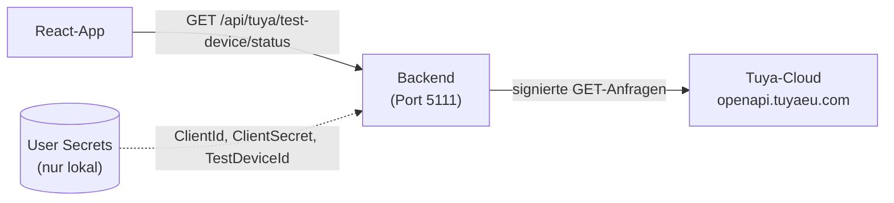

# Tuya-Anbindung (lesend, Zustand optional gespeichert)

Das Backend kann den Zustand **eines** Tuya-Geräts aus der Tuya-Cloud lesen. Es schaltet
nichts, speichert nichts in der Datenbank und legt keine Ereignisse an.



Die Zugangsdaten kennt nur das Backend. Der Browser spricht nie direkt mit Tuya.

## Einrichtung

### 1. Voraussetzungen bei Tuya

- Ein Cloud-Projekt auf der Tuya Developer Platform im Rechenzentrum **Central Europe**
  (passt zu `https://openapi.tuyaeu.com`).
- Das App-Konto (Tuya Smart bzw. Smart Life), in dem das Gerät eingerichtet ist, ist mit dem
  Cloud-Projekt verknüpft. Das Gerät erscheint dann in der Geräteliste des Projekts.
- Aus dem Projekt werden drei Werte gebraucht:
  - **Access ID** → `Tuya:ClientId`
  - **Access Secret** → `Tuya:ClientSecret`
  - **Geräte-ID** des Testgeräts → `Tuya:TestDeviceId`

### 2. Zugangsdaten eintragen

Die Werte gehören **nicht** in `appsettings.json` und nicht ins Git-Repository. Sie liegen
in den .NET User Secrets, also außerhalb des Projektordners
(`~/.microsoft/usersecrets/<UserSecretsId>/secrets.json`).

Am einfachsten mit dem Skript im Projektordner (Bash, braucht `python3` und das .NET SDK):

```bash
./tuya-secrets-einrichten.sh
```

Das Skript

- fragt Client-ID, Client-Secret und TestDeviceId nacheinander ab, die Eingabe bleibt unsichtbar,
- entfernt Leerzeichen am Anfang und Ende und lehnt leere Eingaben ab,
- gibt keinen der Werte aus,
- übergibt die Werte per stdin an `dotnet user-secrets set`. Sie stehen damit weder in der
  Shell-History noch als Kommandozeilenargument in der Prozessliste,
- überschreibt vorhandene Einträge.

Von Hand geht es auch, die Werte landen dann aber in der Shell-History:

```bash
cd backend/HomeControl.Api
dotnet user-secrets set "Tuya:ClientId" "<ACCESS-ID>"
dotnet user-secrets set "Tuya:ClientSecret" "<ACCESS-SECRET>"
dotnet user-secrets set "Tuya:TestDeviceId" "<GERÄTE-ID>"
```

Vorsicht: `dotnet user-secrets list` zeigt die Werte im Klartext an.
Entfernen: `dotnet user-secrets remove "Tuya:ClientSecret"` (einzeln) oder
`dotnet user-secrets clear` (alle Secrets des Projekts).

Nach dem Ändern der Zugangsdaten das **Backend neu starten**. Das leert auch den
Token-Speicher. Zur Sicherheit merkt sich das gespeicherte Token seine ClientId: Passt sie nicht
mehr zur Konfiguration, holt das Backend ein neues Token.

### 3. Konfiguration

| Schlüssel | Wo | Bedeutung |
|---|---|---|
| `Tuya:BaseUrl` | `appsettings.json` | Rechenzentrum, Vorgabe `https://openapi.tuyaeu.com` (Central Europe) |
| `Tuya:ClientId` | User Secrets | Access ID des Cloud-Projekts |
| `Tuya:ClientSecret` | User Secrets | Access Secret des Cloud-Projekts |
| `Tuya:TestDeviceId` | User Secrets | Geräte-ID des Testgeräts |
| `Tuya:LinkedDeviceId` | User Secrets (optional) | Id (GUID) des Geräts **in unserer Datenbank**, auf das der Zustand übertragen wird |

`Tuya:LinkedDeviceId` ist kein Geheimnis, unterscheidet sich aber je Datenbank. Die Id steht in
Scalar unter `GET /api/devices` oder in der Geräteliste. Eintragen im Ordner
`backend/HomeControl.Api`:

```bash
dotnet user-secrets set "Tuya:LinkedDeviceId" "<GERAETE-ID-AUS-DER-DATENBANK>"
```

Danach das Backend neu starten. Ohne diesen Wert funktioniert alles wie bisher, es wird nur
nichts gespeichert.

## Geräteliste und Verknüpfung

`GET /api/tuya/devices` holt alle Geräte der App-Konten, die mit dem Cloud-Projekt verknüpft
sind, über `GET /v1.0/iot-01/associated-users/devices` (Tuya-Doku: „Batch query for the list
of associated App user dimension devices“). Tuya liefert die Liste seitenweise
(`size=50`, `last_row_key` für die nächste Seite). Das Backend holt alle Seiten, aus Sicherheit
aber höchstens 20 (bis zu 1000 Geräte).

- **Nur lesend.** Es wird nichts geschaltet und nichts gespeichert.
- **Kein `local_key`.** Die Tuya-Antwort enthält pro Gerät den `local_key`, einen Schlüssel für
  die lokale Steuerung im Heimnetz. Das Backend liest nur Id, Name, Produktname, Kategorie und
  den Online-Status. Der `local_key` wird nie übernommen, gespeichert, protokolliert oder
  ausgegeben (dafür gibt es einen eigenen Test).
- **Verknüpfen in der Oberfläche:** Auf der Geräteseite gibt es beim Anlegen und Bearbeiten
  das Feld „Tuya-Gerät“. Tuya-Geräte, die schon mit einem anderen Gerät verknüpft sind, sind
  dort ausgegraut. Ist Tuya nicht eingerichtet, erscheint nur ein Hinweis, alles andere
  funktioniert normal.
- **Geräte-Ids in der Datenbank:** Die Tuya-Id steht jetzt am Gerät in der lokalen
  `homecontrol.db` (Feld `TuyaDeviceId`). Eine Geräte-Id allein erlaubt keinen Zugriff, dafür
  braucht man ClientId und ClientSecret, die weiter nur in den User Secrets liegen. Die
  Datenbank ist in `.gitignore` und kommt nicht ins Repository.

Der Abgleich (`POST /api/tuya/test-device/sync`) nutzt vorerst weiter `Tuya:LinkedDeviceId`.
Der nächste Schritt ist ein Abgleich für alle verknüpften Geräte über `TuyaDeviceId`.

## Lesender Statusabruf

`GET /api/tuya/test-device/status`

Das Backend schickt signierte GET-Anfragen an Tuya (HMAC-SHA256, Klassen `TuyaClient` und
`TuyaSignature` im Ordner `Tuya/`):

1. `GET /v1.0/token?grant_type=1`: Zugriffstoken holen, nur wenn kein gültiges im Speicher liegt
2. `GET /v1.0/iot-03/devices/{device_id}/status`: Status lesen

### Token-Cache

Das Token liegt im `TuyaTokenStore` und wird nur im Arbeitsspeicher gehalten, nie in Datei,
Datenbank oder Log.

- **Warum eine eigene Klasse?** `AddHttpClient<TuyaClient>` registriert den `TuyaClient` als
  *transient*, also pro Anfrage neu. Ein Feld im `TuyaClient` wäre nach jedem Abruf wieder leer.
  Der `TuyaTokenStore` ist ein **Singleton** und lebt so lange wie die App.
- **Erneuern:** Tuya liefert die Laufzeit in `expire_time` (Sekunden). Ab **60 Sekunden vor
  Ablauf** wird ein neues Token geholt. Einen Refresh-Token-Ablauf gibt es bewusst nicht.
  Fehlt `expire_time`, wird das Token nicht wiederverwendet.
- **Parallele Abrufe:** Ein `SemaphoreSlim` lässt nur einen Token-Abruf gleichzeitig zu.
  Die anderen warten und nutzen danach dasselbe Token.
- **Abgelehntes Token:** Antwortet Tuya beim Statusabruf mit `success: false` und einem
  Token-Fehler (1010, 1011, 1012 oder 1400, auch bei HTTP 200), wird **genau einmal** mit einem
  neuen Token wiederholt. Andere Fehler werden nicht wiederholt.
- **Zuordnung:** Das Token merkt sich die ClientId, zu der es gehört.
- **Zeit:** Die Uhrzeit kommt aus `TimeProvider`. In Tests wird sie vorgespult.
- Ein fehlgeschlagener Token-Abruf wird nicht gespeichert. Beim nächsten Abruf wird es erneut
  versucht.

Antwort (200):

```jsonc
{
  "retrievedAtUtc": "2026-10-27T08:21:11.921+00:00",
  "status": [
    { "code": "switch_1", "value": false }
    // … weitere Codes, je nach Gerät (beim Testgerät z. B. countdown_1, child_lock, relay_status)
  ],
  "note": "Werte, die die Tuya-Cloud zum Abrufzeitpunkt für das Gerät kennt. Ein erfolgreicher Abruf bedeutet nicht, dass das Gerät online ist."
}
```

- `retrievedAtUtc`: Zeitpunkt, zu dem **unser Backend** bei Tuya abgefragt hat. Wann das
  Gerät den Wert zuletzt an die Cloud gemeldet hat, steht nicht darin.
- `status`: Codes und Werte unverändert von Tuya. Welche Codes es gibt, hängt vom Gerät ab.
- Die Geräte-ID wird bewusst nicht zurückgegeben.

Fehler (ProblemDetails):

| Status | Wann | `title` |
|---|---|---|
| 503 | Eine der drei Einstellungen fehlt. `detail` nennt nur die Namen, nie Werte | „Tuya ist nicht eingerichtet.“ |
| 502 | Tuya lehnt ab (z. B. falsche Zugangsdaten, fehlende Berechtigung). `detail` enthält Code und Meldung von Tuya | „Tuya hat die Anfrage abgelehnt.“ |
| 502 | Keine Verbindung zur Tuya-Cloud | „Die Tuya-Cloud ist nicht erreichbar.“ |
| 502 | Antwort von Tuya hat nicht das erwartete Format | „Unerwartete Antwort von Tuya.“ |
| 504 | Tuya antwortet nicht innerhalb von 10 Sekunden | „Die Tuya-Cloud antwortet nicht.“ |

Schnelltest:

```bash
curl -i http://localhost:5111/api/tuya/test-device/status
```

## Zustand speichern (Abgleich)

`POST /api/tuya/test-device/sync` liest den Status genauso wie der GET-Endpunkt und überträgt
`switch_1` danach auf das in `Tuya:LinkedDeviceId` eingestellte Gerät
(`Tuya/TuyaSwitchRecorder.cs`). Bei Tuya wird dabei weiterhin **nur gelesen**.

- `true` → `IsActive = true`, `LastValue = "EIN"`, `false` → `IsActive = false`,
  `LastValue = "AUS"`.
- Nur wenn sich der Zustand **ändert**, wird zusätzlich ein Ereignis `turned_on` bzw.
  `turned_off` mit dem Abrufzeitpunkt gespeichert. Mehrmals „Aktualisieren“ ohne Änderung
  erzeugt also keine doppelten Einträge.
- Ist `switch_1` kein echter Boolean, fehlt das Gerät oder ist nichts eingestellt, wird
  **nichts** gespeichert. Es wird kein Zustand geraten.
- Es läuft immer nur ein Abgleich gleichzeitig (`SemaphoreSlim`). So können zwei fast
  gleichzeitige Aufrufe, etwa durch React StrictMode im Entwicklungsmodus, kein Ereignis doppelt
  speichern.
- Warum POST und nicht GET? Ein GET soll nichts verändern. Weil hier etwas in die Datenbank
  geschrieben wird, ist es ein POST. Der reine GET-Endpunkt bleibt unverändert bestehen.

## Alle verknüpften Geräte

**Zum Lernen:** [Lernunterlage-Tuya-Geraete.pdf](Lernunterlage-Tuya-Geraete.pdf)
(4 Seiten: Weg eines Messwerts, Begriffe, Statuscodes und Skalierung, Geräte verbinden, was nicht
Tuya ist, Grenzen, Kurzantworten, Merksätze).

Neben dem Testgerät kann das Backend alle Geräte lesen, die auf der Geräteseite im Feld
„Tuya-Gerät“ verknüpft wurden (`Device.TuyaDeviceId`). Zwei Endpunkte, beide nur für angemeldete
Benutzer, weil **jedes Gerät einen Aufruf im Tuya-Kontingent** kostet (höchstens 50 pro Aufruf):

| Endpunkt | Wirkung |
|---|---|
| `GET /api/tuya/linked-devices/status` | Rohwerte (Codes und Werte unverändert) aller verknüpften Geräte. Speichert nichts. |
| `POST /api/tuya/sync` | Wie oben, überträgt aber zusätzlich bekannte Zustände auf unsere Geräte. |

Umsetzung: `Tuya/TuyaDeviceSyncer.cs`. Pro Gerät passiert Folgendes:

| Statuscode | Bedeutung | Gespeichert als |
|---|---|---|
| `switch_1` = `true` / `false` | Steckdose, Licht | `LastValue` EIN / AUS, `IsActive`, Ereignis `turned_on` / `turned_off` |
| `doorcontact_state` = `true` / `false` | Türkontakt | `LastValue` OFFEN / ZU, Ereignis `door_opened` / `door_closed` |

- Es wird nur bei einer **Änderung** ein Ereignis gespeichert (wie beim Testgerät).
- Kein echter Boolean oder kein bekannter Code: `unknownValue`, nichts wird gespeichert.
- Ein Fehler bei einem Gerät (Tuya lehnt ab, Gerät unbekannt) stoppt die anderen nicht. Ist die
  Tuya-Cloud insgesamt nicht erreichbar, wird nach dem ersten Fehler abgebrochen, statt bei jedem
  Gerät auf eine Zeitüberschreitung zu warten.
- Ein Abgleich gleichzeitig (`SemaphoreSlim`), damit keine doppelten Ereignisse entstehen.

### Messwerte: Watt, Volt, Akku

**Zum Lernen:** [Lernunterlage-Tuya-Messwerte.pdf](Lernunterlage-Tuya-Messwerte.pdf)

Tuya liefert Messwerte als **ganze Zahlen mit Skalierungsfaktor**. Die Codes und Faktoren unten
stammen aus den echten Rohwerten unserer Geräte (`./tuya-rohwerte-anzeigen.sh`, 02.11.2026):

| Statuscode | Beispiel roh | Umrechnung | Gespeichert als | Geprüft |
|---|---|---|---|---|
| `cur_power` | `1234` | ÷ 10 → 123,4 W | `PowerWatt` | Tuya-Konvention, mit bekannter Last nachprüfen |
| `cur_voltage` | `2271` | ÷ 10 → 227,1 V | `VoltageVolt` | ja (Netzspannung) |
| `battery_percentage` | `83` | 83 % (0–100) | `BatteryPercent` | ja |

- Messwerte erzeugen **kein Ereignis**. Sie schwanken ständig, der Verlauf bleibt für
  Zustandswechsel (an/aus, auf/zu). Gespeichert wird nur der **letzte Stand** plus Zeitpunkt
  (`MeasuredAtUtc`), kein Verlauf.
- **Offline-Geräte:** Tuya liefert dann den letzten bekannten Stand. Der Abgleich holt einmal pro
  Durchlauf den Online-Zustand (aus demselben 60-Sekunden-Cache wie die Status-LEDs) und übernimmt
  Messwerte nur von Geräten, die nicht offline sind. Werte und Zeitpunkt bleiben sonst stehen.
- Unplausible Werte (Akku über 100, negativ, Text statt Zahl, Kommazahl) werden ignoriert.
- Liefert ein Gerät nur Messwerte (kein `switch_1`, kein Türkontakt), ist das Ergebnis `measured`.
- Oberfläche: Geräte-Kachel mit „Messwerte“ und „Gemessen“, Raumkarte z. B. `ZU · Akku 83 %`.
  Ab 20 % Akku gelb (`components/measurements.ts`).
- **Temperatur fehlt noch:** Kein verknüpftes Gerät liefert bisher einen Temperaturwert. Erst
  Rohwerte ansehen, dann Faktor festlegen, nichts raten.

Rohwerte aller verknüpften Geräte anzeigen (Leseschutz an: Anmeldung mit dem Home-Control-Konto):

```bash
HC_API=http://127.0.0.1:5200 ./tuya-rohwerte-anzeigen.sh
```

## Hintergrund-Abgleich

**Zum Lernen:** [Lernunterlage-Hintergrund-Abgleich.pdf](Lernunterlage-Hintergrund-Abgleich.pdf)

Vorher wurde nur abgeglichen, wenn jemand auf „Mit Tuya abgleichen“ klickte. Am 02.11. meldete Tuya
`doorcontact_state = true`, die App zeigte aber weiter „ZU“, und `door_opened` fehlte im Verlauf.
Jetzt gleicht `Tuya/TuyaSyncBackgroundService.cs` alle verknüpften Geräte regelmäßig ab, auch wenn
niemand die App offen hat.

| Einstellung | Standard | Bedeutung |
|---|---|---|
| `Tuya:AutoSyncSeconds` | `900` (15 min), **beim Entwickeln `0`** | Abstand zwischen zwei Durchläufen. `0` = aus. Werte von 1 bis 59 werden auf 60 angehoben. |

**Beim Entwickeln aus** (`appsettings.Development.json`): Dienst (Port 5200) und `./app-starten.sh` (Port 5111)
benutzen dieselbe Datenbank. Liefen beide Hintergrund-Abgleiche, würde doppelt bei Tuya gefragt (doppeltes
Kontingent) und doppelt in dieselbe Datenbank geschrieben. Gleiches Prinzip wie bei Blink („ein Prozess pro
Datenbank“, siehe [BLINK.md](BLINK.md)). Ohne Hintergrund-Abgleich fragen die Status-LEDs beim Entwickeln Tuya
selbst, höchstens alle 5 Minuten. Einschalten nur bei gestopptem Dienst:
`systemctl --user stop home-control`, dann `Tuya__AutoSyncSeconds=900 ./app-starten.sh`.

- **Ablauf:** erster Durchlauf beim Start, danach im Takt (`PeriodicTimer`). Pro Durchlauf ein eigener
  Scope, dann dieselbe Methode wie der Knopf (`TuyaDeviceSyncer.ReadAllAsync(apply: true)`). Die Sperre
  (`SyncLock`) verhindert, dass Knopf und Hintergrund gleichzeitig laufen.
- **Ohne Zugangsdaten** wird nichts abgefragt. Nachgetragene Zugangsdaten wirken ohne Neustart,
  ein geänderter Takt erst nach einem Neustart.
- **Fehler** (Cloud nicht erreichbar, Ablehnung, Datenbank) landen nur im Log, ohne Geheimnisse. Der
  Dienst stürzt nie ab. **Backoff:** Nach jedem Fehler in Folge verdoppelt sich der Abstand
  (15 → 30 → 60 min), höchstens 1 Stunde. Nach dem ersten Erfolg gilt wieder der normale Takt.
- **Log:** `journalctl --user -u home-control -f`. Eine Zeile gibt es nur, wenn sich etwas geändert hat
  oder ein Fehler auftrat.
- **Status-LEDs:** Solange der Hintergrund-Abgleich läuft, fragt `GET /api/status` Tuya **nicht** selbst,
  sondern liest die Online-Liste des letzten Durchlaufs (`TuyaOnlineCache`). Die Tuya-LED zeigt im
  Tooltip den Stand („Stand 10:15 Uhr“). Ist der Abgleich aus, fragt `/api/status` selbst, höchstens
  alle 5 Minuten.
- **Oberfläche:** Übersicht und Geräteseite laden die Geräteliste jede Minute und beim Zurückkehren in
  die App neu (`hooks/useAutoRefresh.ts`). Das kostet kein Tuya-Kontingent, gelesen wird nur die eigene
  Datenbank.

### Kontingent

Jeder Durchlauf kostet **einen Status-Aufruf pro verknüpftem Gerät** plus **einen Aufruf der
Geräteliste** (online/offline). Dazu kommt etwa alle 2 Stunden ein neues Token (`expire_time`).
Bei 4 Geräten sind das 5 Aufrufe pro Durchlauf:

| Takt | Durchläufe/Tag | Aufrufe/Tag | Aufrufe/Monat (30 Tage) |
|---|---|---|---|
| 1 min | 1 440 | 7 200 | 216 000 |
| 2 min | 720 | 3 600 | 108 000 |
| 5 min | 288 | 1 440 | 43 200 |
| 10 min | 144 | 720 | 21 600 |
| **15 min (Standard)** | **96** | **480** | **14 400** |

Die Produktseite von Tuya IoT Core nennt für die Testversion („nur zum Testen“) **26 000 API-Aufrufe
pro Monat**. Ob das für dein Projekt gilt, steht unter [platform.tuya.com](https://platform.tuya.com)
→ **Cloud** → **My Services** → **IoT Core** (Edition, Ablaufdatum, Verlängerung).

Die **Status-LEDs** hätten ohne den Hintergrund-Abgleich bei dauerhaft offener App (z. B. Tablet an der
Wand) bis zu 1 440 Aufrufe pro Tag gekostet, also rund 43 200 im Monat. Mit dem Hintergrund-Abgleich
kosten sie nichts mehr. Gesamt bei 15 min: etwa **14 800 pro Monat** (Abgleich + Token), dazu
die Klicks auf „Mit Tuya abgleichen“.

Mit mehr Geräten steigt der Verbrauch: Jedes weitere verknüpfte Gerät kostet bei 15 min
2 880 Aufrufe pro Monat.

## Dashboard-Karte „Licht Wohnzimmer“

Die Übersicht zeigt im Abschnitt „Licht (Tuya)“ eine Karte für das Testgerät
(`components/TuyaLightCard.tsx`, Aufruf in `api/tuya.ts`).

- Angezeigt wird der **zuletzt von Tuya gemeldete Zustand** von `switch_1`:
  `true` → **EIN**, `false` → **AUS**. Fehlt der Code oder ist der Wert kein Boolean
  (z. B. `"true"`, `1`, `null`), steht dort **Unbekannt**.
- Darunter steht der Abrufzeitpunkt (`retrievedAtUtc`) in deutscher Ortszeit
  (Zeitzone Europe/Berlin, unabhängig von der Zeitzone des Browsers).
- Abgerufen wird einmal beim Öffnen der Übersicht und danach nur über **Aktualisieren**.
  Die Karte selbst fragt nicht regelmäßig (das macht der Hintergrund-Abgleich). Sie nutzt den Abgleich
  (`POST /api/tuya/test-device/sync`) und zeigt in einer Zeile, ob etwas gespeichert wurde.
- Während des Abrufs ist der Button gesperrt („Wird aktualisiert …“).
- Schlägt eine Aktualisierung fehl, bleibt der alte Zustand stehen, wird abgeschwächt
  dargestellt und mit **Veraltet** gekennzeichnet. Dazu kommt die Fehlermeldung.
- Es gibt keinen Schalter und keine Online-Anzeige.

## Bekannte Grenzen

- **Nur lesend.** Es gibt keinen Endpunkt zum Schalten.
- **Testgerät über die Konfiguration.** Der Abgleich des Testgeräts (`/test-device/sync`) nutzt
  `Tuya:LinkedDeviceId`. Alle anderen Geräte werden über das Feld „Tuya-Gerät“ in der Oberfläche
  verknüpft und mit `POST /api/tuya/sync` abgeglichen (siehe „Alle verknüpften Geräte“).
- **Zustand bei Offline-Geräten.** Gelesen wird, was die Cloud zuletzt über das Gerät weiß.
  Messwerte von Offline-Geräten übernimmt der Abgleich nicht (siehe „Messwerte“), An/Aus und
  Tür auf/zu dagegen schon: Sie zeigen dann den letzten bekannten Zustand.
- **Gespeichert wird nur beim Abgleich**, also beim Knopf und beim Hintergrund-Abgleich (Standard
  alle 15 Minuten), und nur bei einer Änderung. Das ist **Polling** (regelmäßig nachfragen): Was
  zwischen zwei Durchläufen passiert (z. B. Tür kurz auf und wieder zu), sieht das Backend nicht.
  Der Zeitpunkt eines Ereignisses ist der Zeitpunkt des Abrufs, nicht der echten Änderung (bis zu
  15 Minuten später). Genaue Zeitpunkte gäbe es nur mit den Push-Nachrichten von Tuya (Message
  Service), siehe [Lernunterlage-Hintergrund-Abgleich.pdf](Lernunterlage-Hintergrund-Abgleich.pdf).
- **Online/Offline bis zu 15 Minuten alt.** Mit Hintergrund-Abgleich zeigen die Status-LEDs den
  Stand des letzten Durchlaufs.
- **Herkunft nicht gespeichert.** Ein Ereignis aus dem Abgleich sieht im Verlauf genauso aus wie
  ein manuell erfasstes. Dafür bräuchte es ein eigenes Feld und eine Migration.
- **Andere Kacheln aktualisieren sich nicht mit.** Nach „Aktualisieren“ zeigt die Gerätekachel
  im Dashboard den neuen `LastValue` erst nach dem nächsten Laden der Seite.
- **Ein Abgleich gleichzeitig pro Backend-Prozess.** Die Sperre gilt nur innerhalb einer
  laufenden API. Mehrere Backend-Instanzen auf dieselbe Datenbank wären nicht abgesichert.
- **User Secrets nur in `Development`.** ASP.NET Core lädt User Secrets nur in der Umgebung
  `Development`. Für einen Betrieb in einer anderen Umgebung bräuchte es eine andere sichere
  Quelle (z. B. Umgebungsvariablen `Tuya__ClientId` usw.).
- **Ein Rechenzentrum.** Fest auf Central Europe eingestellt. Für ein anderes Rechenzentrum
  muss `Tuya:BaseUrl` geändert werden.
- **Konfigurationswechsel erfordert Neustart.** `TuyaClient` liest die Einstellungen über
  `IOptionsMonitor` und bekommt ein geändertes `Tuya:ClientSecret` sofort zu sehen, ohne
  Neustart. Der Token-Cache merkt sich dabei aber nur die ClientId, nicht das Secret: Bleibt
  die ClientId gleich, verwendet er das alte, noch gültige Token weiter, während neue Anfragen
  schon mit dem neuen Secret signiert werden. Das passt nicht zusammen und führt zu einem
  Signaturfehler (Tuya-Code 1004), der nicht automatisch behoben wird, weil er nicht in der
  Wiederhol-Liste steht. Erst wenn das Token regulär abläuft oder das Backend neu startet,
  greift das neue Secret zuverlässig. Bei einer geänderten ClientId holt der Cache dagegen
  sofort ein neues Token (siehe oben).
- **Token-Cache nur im Arbeitsspeicher.** Nach jedem Neustart wird zuerst ein neues Token
  geholt. Laufen mehrere Backend-Instanzen, hat jede ihr eigenes Token.
- **Karte fest benannt.** „Licht Wohnzimmer“ steht fest im Frontend und wertet nur
  `switch_1` aus. Die Karte ist nicht mit dem Raum „Wohnzimmer“ oder dessen Geräten in der
  Datenbank verbunden.
- **Fehlermeldung ohne Tuya-Code.** Die Karte zeigt nur den `title` der Fehlerantwort. Code
  und Meldung von Tuya stehen in `detail` und im Server-Log.
- **Tests für Token-Cache und Abgleich.** `HomeControl.Api.Tests` prüft den Cache mit einem
  eigenen Fake-`HttpMessageHandler` (ohne Internet) und den Abgleich mit einer SQLite-Datenbank
  im Arbeitsspeicher. Für die Signatur und die Endpunkte gibt es noch keine Tests.

## Tests

```bash
dotnet test   # im Projektordner, führt HomeControl.Api.Tests aus
```

`TuyaSyncBackgroundServiceTests` prüft den Hintergrund-Abgleich mit Microsofts `FakeTimeProvider`
(Zeit vorstellen statt warten): Durchlauf speichert `door_opened`, ohne Zugangsdaten kein Aufruf,
Fehler werden geloggt statt geworfen, Backoff bis 1 Stunde, `0` = aus, Takt und sauberes Stoppen.
`StatusCacheModeTests` zählt die Tuya-Aufrufe von `GET /api/status`: mit Hintergrund-Abgleich keiner,
ohne höchstens einer in 5 Minuten.

`TuyaTokenCacheTests` prüft unter anderem: Wiederverwendung des Tokens, Erneuern ab 60 Sekunden
vor Ablauf, nur ein Token-Abruf bei fünf parallelen Abrufen, eine Wiederholung bei Token-Fehler
im Body, keine Wiederholung bei anderen Fehlern, neues Token bei anderer ClientId.

`TuyaDeviceListTests` prüft die Geräteliste: eine Seite, mehrere Seiten (mit sortierten
Query-Parametern für die Signatur), Abbruch nach 20 Seiten, leere Liste, Tuya-Fehler und dass der
`local_key` nirgends im Ergebnis auftaucht.

`TuyaSwitchRecorderTests` prüft mit einer eigenen SQLite-Datenbank im Arbeitsspeicher (die echte
`homecontrol.db` bleibt unberührt): EIN und AUS beim ersten Abruf, kein zweites Ereignis bei
gleichem Zustand, Wechsel EIN → AUS, nichts speichern bei `"true"`, `1`, `null` oder fehlendem
`switch_1`, nichts speichern ohne Verknüpfung oder bei unbekanntem bzw. ungültigem Gerät.
Die Tests nutzen eigene Fakes (`FakeTuyaHandler`, `FakeTimeProvider`, `TestOptionsMonitor`),
kein Mocking-Framework.
