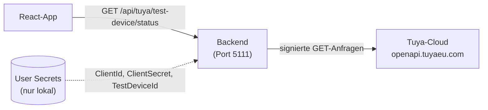

# Tuya-Anbindung (nur lesend)

Das Backend kann den Zustand **eines** Tuya-Geräts aus der Tuya-Cloud lesen. Es schaltet
nichts, speichert nichts in der Datenbank und legt keine Ereignisse an.



Die Zugangsdaten kennt nur das Backend. Der Browser spricht nie direkt mit Tuya.

## Einrichtung

### 1. Voraussetzungen bei Tuya

- Ein Cloud-Projekt auf der Tuya Developer Platform im Rechenzentrum **Central Europe**
  (passt zu `https://openapi.tuyaeu.com`).
- Das App-Konto (Tuya Smart bzw. Smart Life), in dem das Gerät eingerichtet ist, ist mit dem
  Cloud-Projekt verknüpft. Das Gerät erscheint dann in der Geräteliste des Projekts.
- Aus dem Projekt werden drei Werte gebraucht:
  - **Access ID** → `Tuya:ClientId`
  - **Access Secret** → `Tuya:ClientSecret`
  - **Geräte-ID** des Testgeräts → `Tuya:TestDeviceId`

### 2. Zugangsdaten eintragen

Die Werte gehören **nicht** in `appsettings.json` und nicht ins Git-Repository. Sie liegen
in den .NET User Secrets, also außerhalb des Projektordners
(`~/.microsoft/usersecrets/<UserSecretsId>/secrets.json`).

Am einfachsten mit dem Skript im Projektordner (Bash, braucht `python3` und das .NET SDK):

```bash
./tuya-secrets-einrichten.sh
```

Das Skript

- fragt Client-ID, Client-Secret und TestDeviceId nacheinander ab, die Eingabe bleibt unsichtbar,
- entfernt Leerzeichen am Anfang und Ende und lehnt leere Eingaben ab,
- gibt keinen der Werte aus,
- übergibt die Werte per stdin an `dotnet user-secrets set`. Sie stehen damit weder in der
  Shell-History noch als Kommandozeilenargument in der Prozessliste,
- überschreibt vorhandene Einträge.

Von Hand geht es auch, die Werte landen dann aber in der Shell-History:

```bash
cd backend/HomeControl.Api
dotnet user-secrets set "Tuya:ClientId" "<ACCESS-ID>"
dotnet user-secrets set "Tuya:ClientSecret" "<ACCESS-SECRET>"
dotnet user-secrets set "Tuya:TestDeviceId" "<GERÄTE-ID>"
```

Vorsicht: `dotnet user-secrets list` zeigt die Werte im Klartext an.
Entfernen: `dotnet user-secrets remove "Tuya:ClientSecret"` (einzeln) oder
`dotnet user-secrets clear` (alle Secrets des Projekts).

Nach dem Ändern der Zugangsdaten das **Backend neu starten**. Das leert auch den
Token-Speicher. Zur Sicherheit merkt sich das gespeicherte Token seine ClientId: Passt sie nicht
mehr zur Konfiguration, holt das Backend ein neues Token.

### 3. Konfiguration

| Schlüssel | Wo | Bedeutung |
|---|---|---|
| `Tuya:BaseUrl` | `appsettings.json` | Rechenzentrum, Vorgabe `https://openapi.tuyaeu.com` (Central Europe) |
| `Tuya:ClientId` | User Secrets | Access ID des Cloud-Projekts |
| `Tuya:ClientSecret` | User Secrets | Access Secret des Cloud-Projekts |
| `Tuya:TestDeviceId` | User Secrets | Geräte-ID des Testgeräts |

## Lesender Statusabruf

`GET /api/tuya/test-device/status`

Das Backend schickt signierte GET-Anfragen an Tuya (HMAC-SHA256, Klassen `TuyaClient` und
`TuyaSignature` im Ordner `Tuya/`):

1. `GET /v1.0/token?grant_type=1`: Zugriffstoken holen, nur wenn kein gültiges im Speicher liegt
2. `GET /v1.0/iot-03/devices/{device_id}/status`: Status lesen

### Token-Cache

Das Token liegt im `TuyaTokenStore` und wird nur im Arbeitsspeicher gehalten, nie in Datei,
Datenbank oder Log.

- **Warum eine eigene Klasse?** `AddHttpClient<TuyaClient>` registriert den `TuyaClient` als
  *transient*, also pro Anfrage neu. Ein Feld im `TuyaClient` wäre nach jedem Abruf wieder leer.
  Der `TuyaTokenStore` ist ein **Singleton** und lebt so lange wie die App.
- **Erneuern:** Tuya liefert die Laufzeit in `expire_time` (Sekunden). Ab **60 Sekunden vor
  Ablauf** wird ein neues Token geholt. Einen Refresh-Token-Ablauf gibt es bewusst nicht.
  Fehlt `expire_time`, wird das Token nicht wiederverwendet.
- **Parallele Abrufe:** Ein `SemaphoreSlim` lässt nur einen Token-Abruf gleichzeitig zu.
  Die anderen warten und nutzen danach dasselbe Token.
- **Abgelehntes Token:** Antwortet Tuya beim Statusabruf mit `success: false` und einem
  Token-Fehler (1010, 1011, 1012 oder 1400, auch bei HTTP 200), wird **genau einmal** mit einem
  neuen Token wiederholt. Andere Fehler werden nicht wiederholt.
- **Zuordnung:** Das Token merkt sich die ClientId, zu der es gehört.
- **Zeit:** Die Uhrzeit kommt aus `TimeProvider`. In Tests wird sie vorgespult.
- Ein fehlgeschlagener Token-Abruf wird nicht gespeichert. Beim nächsten Abruf wird es erneut
  versucht.

Antwort (200):

```jsonc
{
  "retrievedAtUtc": "2026-10-27T08:21:11.921+00:00",
  "status": [
    { "code": "switch_1", "value": false }
    // … weitere Codes, je nach Gerät (beim Testgerät z. B. countdown_1, child_lock, relay_status)
  ],
  "note": "Werte, die die Tuya-Cloud zum Abrufzeitpunkt für das Gerät kennt. Ein erfolgreicher Abruf bedeutet nicht, dass das Gerät online ist."
}
```

- `retrievedAtUtc`: Zeitpunkt, zu dem **unser Backend** bei Tuya abgefragt hat. Wann das
  Gerät den Wert zuletzt an die Cloud gemeldet hat, steht nicht darin.
- `status`: Codes und Werte unverändert von Tuya. Welche Codes es gibt, hängt vom Gerät ab.
- Die Geräte-ID wird bewusst nicht zurückgegeben.

Fehler (ProblemDetails):

| Status | Wann | `title` |
|---|---|---|
| 503 | Eine der drei Einstellungen fehlt. `detail` nennt nur die Namen, nie Werte | „Tuya ist nicht eingerichtet.“ |
| 502 | Tuya lehnt ab (z. B. falsche Zugangsdaten, fehlende Berechtigung). `detail` enthält Code und Meldung von Tuya | „Tuya hat die Anfrage abgelehnt.“ |
| 502 | Keine Verbindung zur Tuya-Cloud | „Die Tuya-Cloud ist nicht erreichbar.“ |
| 502 | Antwort von Tuya hat nicht das erwartete Format | „Unerwartete Antwort von Tuya.“ |
| 504 | Tuya antwortet nicht innerhalb von 10 Sekunden | „Die Tuya-Cloud antwortet nicht.“ |

Schnelltest:

```bash
curl -i http://localhost:5111/api/tuya/test-device/status
```

## Dashboard-Karte „Licht Wohnzimmer“

Die Übersicht zeigt im Abschnitt „Licht (Tuya)“ eine Karte für das Testgerät
(`components/TuyaLightCard.tsx`, Aufruf in `api/tuya.ts`).

- Angezeigt wird der **zuletzt von Tuya gemeldete Zustand** von `switch_1`:
  `true` → **EIN**, `false` → **AUS**. Fehlt der Code oder ist der Wert kein Boolean
  (z. B. `"true"`, `1`, `null`), steht dort **Unbekannt**.
- Darunter steht der Abrufzeitpunkt (`retrievedAtUtc`) in deutscher Ortszeit
  (Zeitzone Europe/Berlin, unabhängig von der Zeitzone des Browsers).
- Abgerufen wird einmal beim Öffnen der Übersicht und danach nur über **Aktualisieren**.
  Es gibt kein automatisches Polling.
- Während des Abrufs ist der Button gesperrt („Wird aktualisiert …“).
- Schlägt eine Aktualisierung fehl, bleibt der alte Zustand stehen, wird abgeschwächt
  dargestellt und mit **Veraltet** gekennzeichnet. Dazu kommt die Fehlermeldung.
- Es gibt keinen Schalter und keine Online-Anzeige.

## Bekannte Grenzen

- **Nur lesend.** Es gibt keinen Endpunkt zum Schalten.
- **Nur ein Testgerät.** Die Geräte-ID kommt aus der Konfiguration. Das Testgerät ist nicht
  mit den Geräten in der Datenbank verknüpft.
- **Kein Online-Status.** Gelesen wird, was die Cloud zuletzt über das Gerät weiß. Ein
  erfolgreicher Abruf heißt nicht, dass das Gerät gerade erreichbar ist oder dass der Wert
  noch stimmt. Den Online-Zustand fragt das Backend nicht ab.
- **Nichts wird gespeichert.** Kein Eintrag in der Datenbank, keine Ereignisse. `IsActive`
  und `LastValue` bleiben unverändert.
- **User Secrets nur in `Development`.** ASP.NET Core lädt User Secrets nur in der Umgebung
  `Development`. Für einen Betrieb in einer anderen Umgebung bräuchte es eine andere sichere
  Quelle (z. B. Umgebungsvariablen `Tuya__ClientId` usw.).
- **Ein Rechenzentrum.** Fest auf Central Europe eingestellt. Für ein anderes Rechenzentrum
  muss `Tuya:BaseUrl` geändert werden.
- **Konfigurationswechsel erfordert Neustart.** `TuyaClient` liest die Einstellungen über
  `IOptionsMonitor` und bekommt ein geändertes `Tuya:ClientSecret` sofort zu sehen, ohne
  Neustart. Der Token-Cache merkt sich dabei aber nur die ClientId, nicht das Secret: Bleibt
  die ClientId gleich, verwendet er das alte, noch gültige Token weiter, während neue Anfragen
  schon mit dem neuen Secret signiert werden. Das passt nicht zusammen und führt zu einem
  Signaturfehler (Tuya-Code 1004), der nicht automatisch behoben wird, weil er nicht in der
  Wiederhol-Liste steht. Erst wenn das Token regulär abläuft oder das Backend neu startet,
  greift das neue Secret zuverlässig. Bei einer geänderten ClientId holt der Cache dagegen
  sofort ein neues Token (siehe oben).
- **Token-Cache nur im Arbeitsspeicher.** Nach jedem Neustart wird zuerst ein neues Token
  geholt. Laufen mehrere Backend-Instanzen, hat jede ihr eigenes Token.
- **Karte fest benannt.** „Licht Wohnzimmer“ steht fest im Frontend und wertet nur
  `switch_1` aus. Die Karte ist nicht mit dem Raum „Wohnzimmer“ oder dessen Geräten in der
  Datenbank verbunden.
- **Fehlermeldung ohne Tuya-Code.** Die Karte zeigt nur den `title` der Fehlerantwort. Code
  und Meldung von Tuya stehen in `detail` und im Server-Log.
- **Tests nur für den Token-Cache.** `HomeControl.Api.Tests` prüft den Cache mit einem
  eigenen Fake-`HttpMessageHandler` (ohne Internet). Für die Signatur und die Endpunkte gibt es
  noch keine Tests.

## Tests

```bash
dotnet test   # im Projektordner, führt HomeControl.Api.Tests aus
```

`TuyaTokenCacheTests` prüft unter anderem: Wiederverwendung des Tokens, Erneuern ab 60 Sekunden
vor Ablauf, nur ein Token-Abruf bei fünf parallelen Abrufen, eine Wiederholung bei Token-Fehler
im Body, keine Wiederholung bei anderen Fehlern, neues Token bei anderer ClientId.
Die Tests nutzen eigene Fakes (`FakeTuyaHandler`, `FakeTimeProvider`, `TestOptionsMonitor`),
kein Mocking-Framework.
